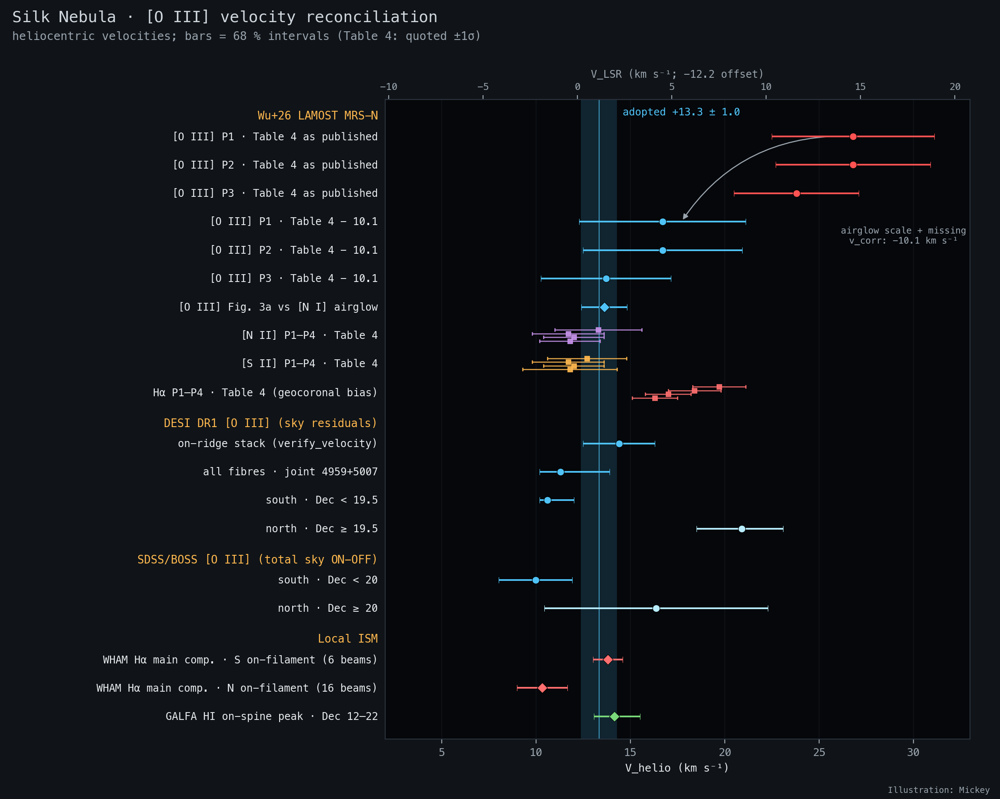
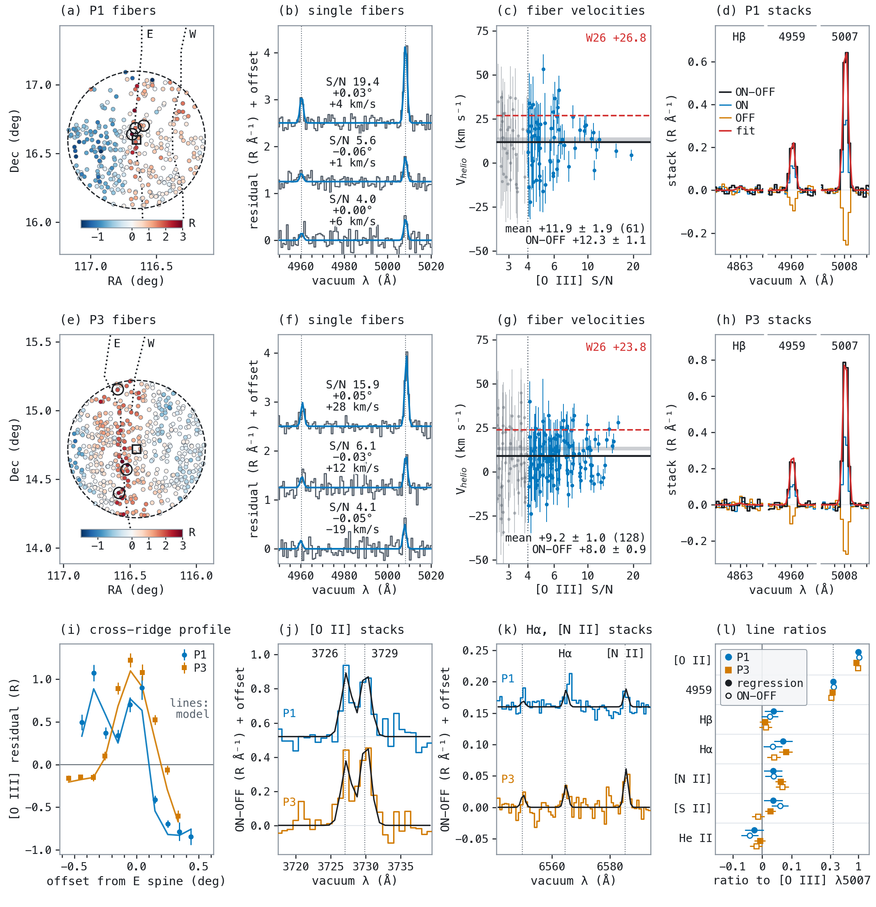
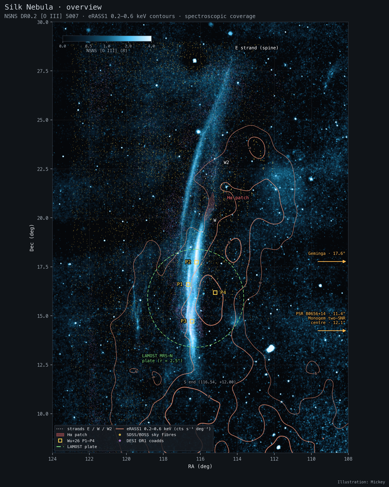
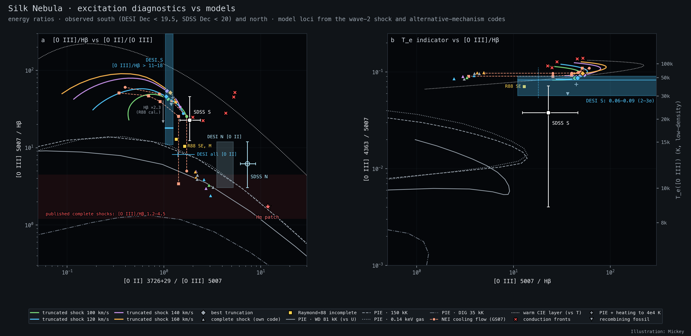

# Silk Nebula study

This is an independent study of the Silk Nebula, a 17°-long [O III] filament in Gemini. It re-examines Wu et al. 2026 (AJ 172, 298; arXiv:2610.13329). That paper used LAMOST MRS-N spectra to call the filament a possible old supernova remnant at ~160 pc.

## The key finding: calibration and unit errors in Wu et al. 2026

The paper's velocities, distance and brightness were checked against its own published figures and against independent spectra (DESI DR1, SDSS/BOSS, WHAM). They do not hold up. Four errors carry its quantitative case:

1. **The [O III] velocity is a wavelength-reference artefact, +10.1 ± 1.0 km/s too high.**
   - The paper's blue-arm spectra are on an air-wavelength, topocentric scale: in its own Fig. 3a, the [N I] 5198/5200 airglow sits at its *air* rest wavelengths (offset +1.8 ± 0.8 km/s). The −8.32 km/s heliocentric correction is therefore missing.
   - Measured against that airglow, [O III] is at V_helio = +13.6 ± 1.2 km/s. Combined with DESI and SDSS, it is **+13.3 ± 1.0 km/s** (V_LSR +1.2), not +23.8…+26.8.
   - It then moves with the paper's own [N II] and [S II] ([O III] − [N II] = +1.1 ± 1.3 km/s). The "10–16 km/s" line offset and the two-layer-shell interpretation built on it disappear.
2. **The Hα velocities are +5.5 ± 1.1 km/s too red.**
   - Hα is offset from the [N II] and [S II] in the same red-arm spectra and from WHAM. The offset is just as large in the nebula-free region P4.
   - The wavelength frame is fine, so this is not a frame error. The most plausible cause is over-subtraction of the geocoronal Hα sky line, which lies within one resolution element of the nebular line.
3. **"~160 pc" is a unit slip, and the kinematics give no distance anyway.**
   - Table 4's `kd` distances are in kpc, not "units of 100 pc", so the paper's own value is ~1.6 kpc.
   - Either way, toward the Galactic anticentre, rotation adds only about 8–10 km/s per kpc, less than typical peculiar motions (7–10 km/s). No kinematic distance is possible here.
   - The size, energy and age scaled from 160 pc fall with it.
4. **The surface brightness is 4.6–8.6× too high.**
   - Table 3's ~10–13 R compares with 1.4–2.5 R from DESI, SDSS fibres, SDSS imaging and NSNS.
   - No identified multiplicative calibration factor accounts for the excess. An additive background error of 7.9–11.3 R would.

A smaller problem: the paper's V_LSR column is not V_helio plus one constant per region, and it scatters by −2.8…+2.6 km/s.

What the paper gets right: the [O III] detection is real, the Gaussian line fits and the [N II]/[S II] velocities are sound, and the red-arm lines do trace the diffuse warm ionized medium.

![The [O III] velocity artefact: the paper's Fig. 3a airglow on an air, topocentric scale, the [O III] line on the same scale, and a velocity ladder of all datasets](figures/dispute_oiii_fig3.png)

*The [O III] velocity artefact (DISPUTE Figure C3):*
- *(a) The [N I] airglow in the paper's Fig. 3a, re-extracted from the PDF vectors, sits at its air, topocentric rest wavelengths. An air-heliocentric scale is excluded at 12σ and a vacuum scale at 87σ.*
- *(b) On the same scale, [O III] 5007 peaks where a true V_helio of +13.3 km/s falls, not +25.*
- *(c) A velocity ladder: the paper's Table 4 (red), the corrected values (green), DESI, SDSS, the paper's [N II]/[S II], WHAM Hα and the paper's Hα.*

![[O III] 5007 brightness by dataset: Table 3 at 10–13 R against a southern consensus of 1.4–2.5 R](figures/w3_figs_f3_brightness.png)

*[O III] 5007 brightness by dataset, with the angular scale of each measurement (REPORT Figure 3). Table 3 (red) sits at 10–13 R, while the southern-ridge consensus from DESI, SDSS and NSNS is 1.4–2.5 R.*

## Velocity comparison

[VELOCITY.md](VELOCITY.md) (English) and [VELOCITY_zh.md](VELOCITY_zh.md) (简体中文), together in the bilingual page [VELOCITY.html](VELOCITY.html), put every [O III], Hα, [N II] and [S II] velocity side by side. The values come from the paper's Table 4, DESI, SDSS/BOSS, WHAM and GALFA-HI. The page:
- defines V_topo, V_helio and V_LSR;
- gives the Earth-motion (v_corr) and Sun-motion (LSR) corrections for each region, and explains why only the first decides who is right;
- lists air and vacuum rest wavelengths and each dataset's native frame;
- ends with a right/wrong verdict table.



*All velocities, in V_helio (bottom axis) and V_LSR (top axis) (REPORT Figure 5). Table 4's [O III] sits ~10 km/s above everything else. Once corrected, and when re-measured against the paper's own airglow, it joins DESI, SDSS, the paper's [N II]/[S II], WHAM Hα and local HI at +13.3 ± 1.0 km/s. The paper's Hα sits ~5 km/s high.*

## The comment paper (manuscript)

[paper/silk_comment.pdf](paper/silk_comment.pdf) is a journal-style comment on Wu et al. 2026, written in AASTeX 6.31 (27 pages, 10 figures, 4 tables, plus an appendix). Author, affiliation and repository URL are placeholders. It covers:
- **Six points on the paper:** the [O III] wavelength-reference artifact, the Hα velocity bias, the Table 4 units and the absence of kinematic distance information, the surface-brightness overestimate, the red-line shock classification, and the other remnant diagnostics.
- **New constraints:** the filament's own DESI DR1 and SDSS spectrum (Balmer-dark, [O II]-strong), its ultraviolet counterpart and the lack of Hα, H I, dust and X-ray counterparts, the excitation mechanism, and the location.
- **Decisive observations:** far-ultraviolet and deep optical spectroscopy, a two-epoch proper motion, and high-ion absorption toward bracketing white dwarfs.
- **Appendix A:** detection and line fitting in the individual DESI DR1 spectra within 0.5° of regions P1 and P3 (velocities, line strengths, line ratios). These are coadded spectra of galaxy and quasar targets with the redshift model subtracted, not DESI sky fibers.

Where the paper and the earlier write-ups (`DISPUTE.md`, `REPORT.md`) differ, the paper is the later version. The main differences:
- The Hβ limit behind the bound on a complete shock is 0.15 R (2σ), not 0.057 R.
- The "+1" in the paper's printed age formula is treated as a misprint that does not affect its quoted age.
- The DESI brightness near P1 and P3 carries about 20% calibration uncertainty, because two survey-validation tiles have no guide-camera fiber acceptance in DR1.
- Near P3 the DESI [O III] velocity is 4–5 km/s below the adopted +13.3 ± 1.0 km/s.



*Paper Figure A1. DESI DR1 coadds within 0.5° of P1 (top row) and P3 (middle row): fibers on the ridge, single-fiber [O III] fits, fiber velocities against S/N, and stacked spectra; bottom row: the cross-ridge profile, [O II] and Hα/[N II] stacks, and line ratios.*

Build and regenerate:

```bash
cd ~/astronomy/silk-nebula/paper
latexmk -pdf silk_comment.tex                       # sections/*.tex + references.bib -> silk_comment.pdf
tools/check_section.sh sections/s2_velocity.tex     # compile one section on its own

cd ~/astronomy/silk-nebula                          # paper figures: light theme, no title or credit line
SILK_THEME=light SILK_PAPER=1 ~/.venvs/astro313/bin/python -I scripts/dispute_oiii_figure.py
SILK_THEME=light SILK_PAPER=1 ~/.venvs/astro313/bin/python -I scripts/paper_appendix_desi.py   # Appendix A analysis and figure
```

The paper figures come from the same scripts as the report figures. With `SILK_THEME=light SILK_PAPER=1`, `scripts/silk_style.py` switches to a light palette, drops titles and credit lines, embeds TrueType fonts, uses American spelling and writes PNG and PDF to `paper/figures/`. Without those variables the scripts reproduce the dark figures in `figures/` unchanged. The Appendix A method and numbers are documented in [notes/paper_appendix_desi.md](notes/paper_appendix_desi.md).

## Comment on Wu et al. 2026

[DISPUTE.md](DISPUTE.md) and [DISPUTE.html](DISPUTE.html) are the earlier, longer working version of the comment, superseded by the manuscript above where they differ. Its Summary is bilingual (English and 中文, with an EN | 中文 switch in the HTML); the rest is in English. It covers six disputed claims, each with dedicated figures (Figures C1–C6), tables (Tables C1–C7), requested corrections and a verified reference list. The claims are:
1. the Table 4 kpc/100-pc unit misreading;
2. why no kinematic distance is possible;
3. the [O III] wavelength-reference artefact;
4. the Hα velocity bias;
5. the Table 3 brightness overestimate;
6. the remaining diagnostics (line ratios, [S II] density, temperature, turbulence, abundances, energetics, line widths).

## The full report

Read [REPORT.md](REPORT.md) (English) or [REPORT_zh.md](REPORT_zh.md) (简体中文). The self-contained, bilingual page [REPORT.html](REPORT.html) embeds all figures and has an EN | 中文 switch at the top right. The page remembers your choice, and `REPORT.html#zh` or `#en` opens a given language. Figures carry English labels in both versions; captions are translated. The report covers:
- **Discovery:** the history and characteristics of the arc. It is 16.9° long and 0.28° wide, and three teams found it independently.
- **Precovery:** archival imaging and spectra that show it back to SDSS in 2002.
- **Structure across the filament:** [O III] and GALEX FUV/NUV show the same narrow ridge; Hα, HI, dust and X-rays do not.
- **The filament's own spectrum:** new DESI DR1 and SDSS/BOSS measurements show strong [O II] and almost no Balmer emission.
- **The review of Wu et al. 2026:** claim by claim (summarised above).
- **A revised hypothesis:** an incompletely cooled radiative shock seen edge-on, most plausibly on the outer limb of the Monogem Ring at ~250–320 pc.



*Overview (REPORT Figure 1). NSNS DR0.2 [O III] map (S. Ziegenbalg) with:*
- *the traced E/W/W2 strands and the Hα patch;*
- *the paper's regions P1–P4 and the LAMOST 5° plate;*
- *Monogem eRASS1 0.2–0.6 keV contours;*
- *the SDSS/BOSS sky fibres (yellow dots) and DESI DR1 coadds (violet dots) used here.*

![Profiles across the southern spine in [O III], GALEX, Hα, HI, 100 µm and X-rays](figures/w3_figs_f6_profiles.png)

*Profiles across the southern spine (REPORT Figure 4).*
- *[O III] (NSNS, DESI) and GALEX FUV/NUV show the same narrow ridge.*
- *SHASSA Hα, GALFA-HI, IRIS 100 µm and eRASS1 X-rays show none.*
- *The X-ray gradient matches rotations about PSR B0656+14.*

![The filament's own DESI and SDSS/BOSS spectrum normalised to [O III] 5007](figures/w3_figs_f4_spectra.png)

*The filament's own spectrum, from the DESI regression and the SDSS/BOSS total-sky ON−OFF, normalised to [O III] 5007 (REPORT Figure 6).*
- *[O II] is about as strong as [O III].*
- *Hβ is weak; the reference curves show [O III]/Hβ = 3 and 11.*
- *[O III] 4363 appears at the [O III] wavelength, not at the Hg I sky line.*
- *The SDSS [O II] panel uses the wave-2 BOSS stack ([O II]/[O III] ≈ 1.8). The current southern value is 1.17 (REPORT §4.2).*



*Observed line ratios against model loci (REPORT Figure 7). The models are truncated and complete shocks, photoionization (hot white dwarf, 150 kK, 0.14 keV gas, DIG), cooling flows, warm-CIE layers, conduction fronts and fossil gas. Two caveats:*
- *The shock tracks are wave-2 runs (100–160 km/s), fitted before a withdrawn [O III]/Hβ value was corrected. The wave-4 refit prefers v_s ≈ 80–120 km/s.*
- *The SDSS-south point shows the superseded [O II]/[O III] = 1.84.*

## Where things are

| Path | Contents |
|---|---|
| `notes/` | Per-topic working notes, in four waves: `discovery`…`spectra_ism` (wave 1), `verify_*` (wave 2), `w3_*` (wave 3), `w4_*` (wave 4). The canonical values are in `w3_canon.md`. Later waves supersede earlier ones. The comment's section drafts are in `notes/dispute/` |
| `figures/` | All figures. The report uses `w3_figs_f1…f7`; the comment uses `dispute_*` |
| `paper/` | The comment manuscript: `silk_comment.tex`, `sections/`, `references.bib`, `figures/` (light theme, PDF and PNG) and the compiled `silk_comment.pdf` |
| `scripts/` | Analysis code. Shared helpers: `silk_geometry.py`, `silk_style.py` (dark by default; light paper mode by environment variable). `paper_appendix_desi.py` makes the paper's Appendix A |
| `data/raw/` | Downloads, one folder per source (**local only, not in git**) |
| `data/derived/` | Measurements, `silk_trace.json`, `w3_canon_values.json`, per-wave agent results, `report_factcheck.json` (**local only, not in git**) |
| `sources/` | Web captures. The paper itself (`sources/arxiv/`) is **local only, not in git**; see below |

## Rebuild the HTML pages

```bash
cd ~/astronomy/silk-nebula
~/.venvs/astro313/bin/python scripts/make_report_html.py            # REPORT.md + REPORT_zh.md -> REPORT.html
~/.venvs/astro313/bin/python scripts/make_report_html.py VELOCITY   # VELOCITY.md + VELOCITY_zh.md -> VELOCITY.html
~/.venvs/astro313/bin/python scripts/dispute_assemble.py            # notes/dispute/*.md -> DISPUTE.md
~/.venvs/astro313/bin/python scripts/make_report_html.py DISPUTE    # DISPUTE.md -> DISPUTE.html
```

`DISPUTE.md` is generated: edit the drafts in `notes/dispute/`, not the assembled file.

Run the individual analyses with `~/.venvs/astro313/bin/python -I scripts/<name>.py`. Each note lists its own scripts and inputs.

## Access limits encountered (2026-11-16/17)

- NERSC hosts (`data.desi.lbl.gov`, `legacysurvey.org`) were unreachable through the local proxy. As a result:
  - DESI spectra came from NOIRLab SPARCL;
  - DESI sky fibres and per-petal sky models were not used;
  - Legacy Surveys images were not used.
- LAMOST MRS-N nebular fibre spectra are not public.

## Repository and local data

`data/` is kept out of git (see `.gitignore`). It holds ~7 GB of survey downloads and ~0.6 GB of derived products. Each note in `notes/` names the scripts and inputs it used.
- **Re-downloading:** the fetch scripts in `scripts/` (`*_fetch*.py`, `*_query*.py`) re-download the public inputs, from DESI DR1 via SPARCL, SDSS, GALEX, eROSITA DR1, WHAM, GALFA-HI, NSNS and others.
- **Not reproducible from the repository alone:** the results in `data/derived/`. Rebuilding them means re-running the analysis scripts on those downloads.

The paper is also kept out of git, because arXiv's default licence does not allow redistribution. Several scripts expect it at `sources/arxiv/`, so to reproduce the paper-based checks, fetch it there:

```bash
mkdir -p sources/arxiv && cd sources/arxiv
curl -L -o 2610.13329v1.pdf https://arxiv.org/pdf/2610.13329v1
pdftotext -layout 2610.13329v1.pdf 2610.13329v1.txt
```

The page renders and figure crops in `sources/arxiv/figs/` were made by hand from 300-dpi `pdftoppm` renders of the PDF; no script regenerates them. To recreate one (e.g. `fig5b_crop.png`, the crop of the paper's Fig. 5b that Section 1 of the comment digitizes), render the page with `pdftoppm -r 300 -png` and crop it. `scripts/verify_velocity_fig3_vectors.py` reads the Fig. 3 vectors straight from the PDF.
