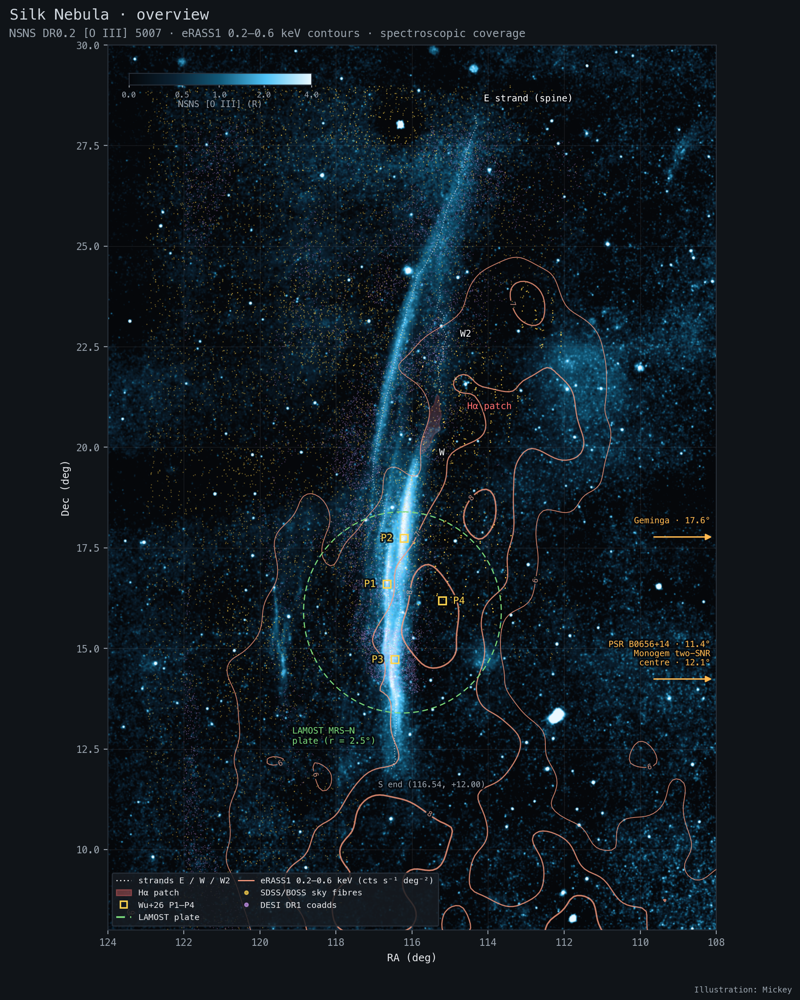
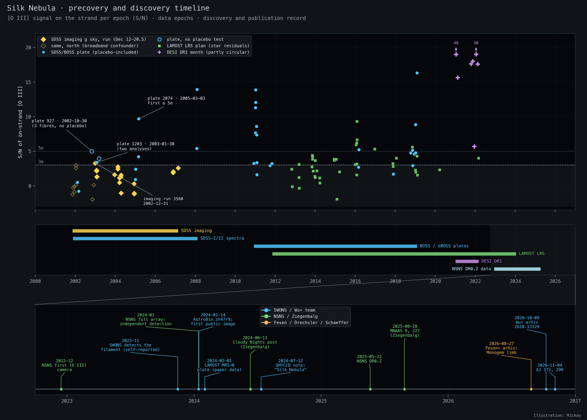
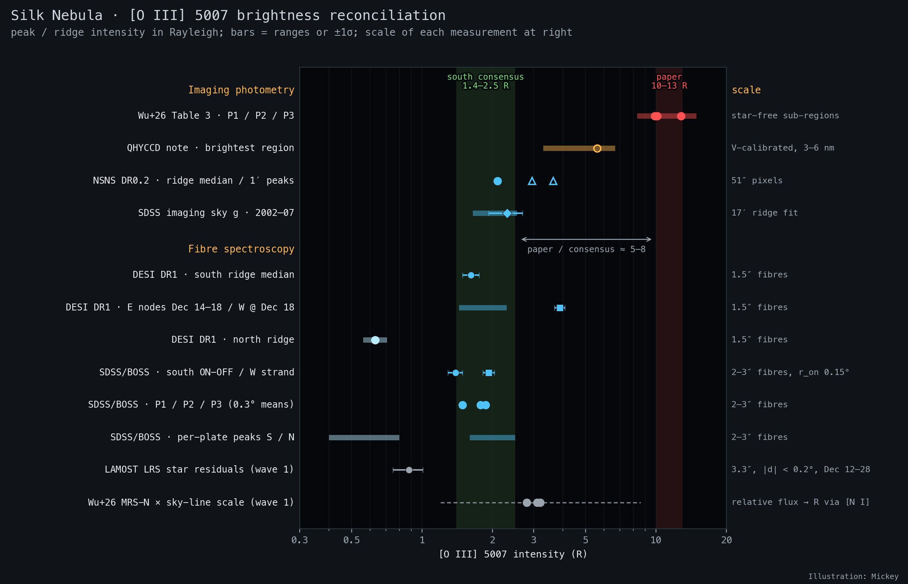
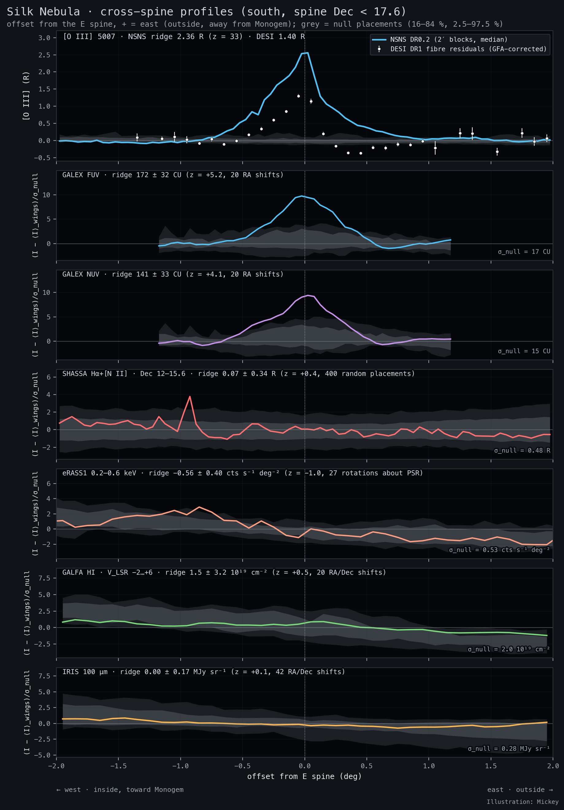
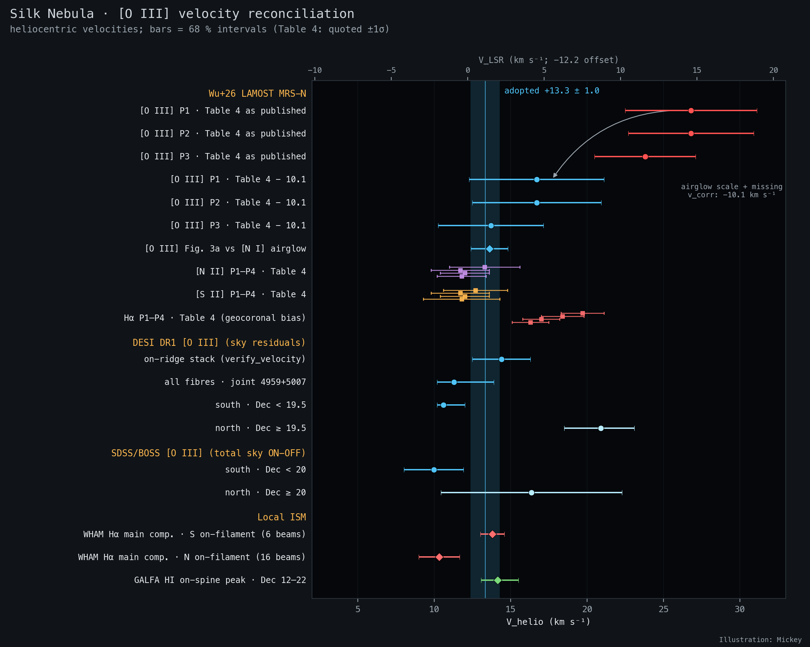
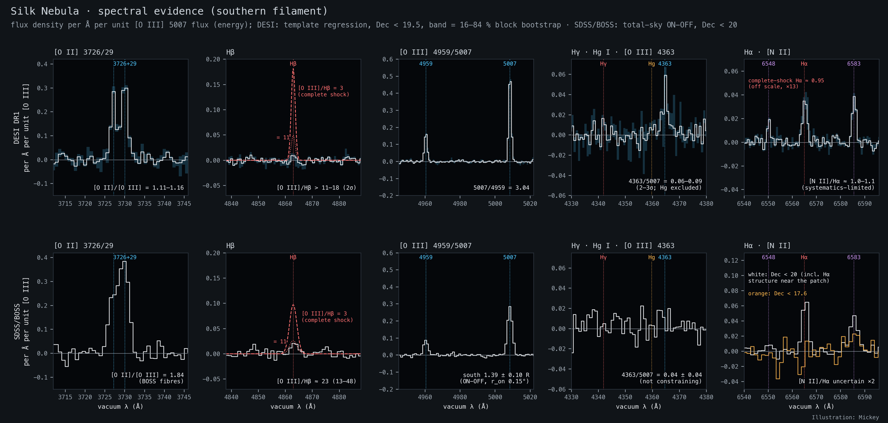
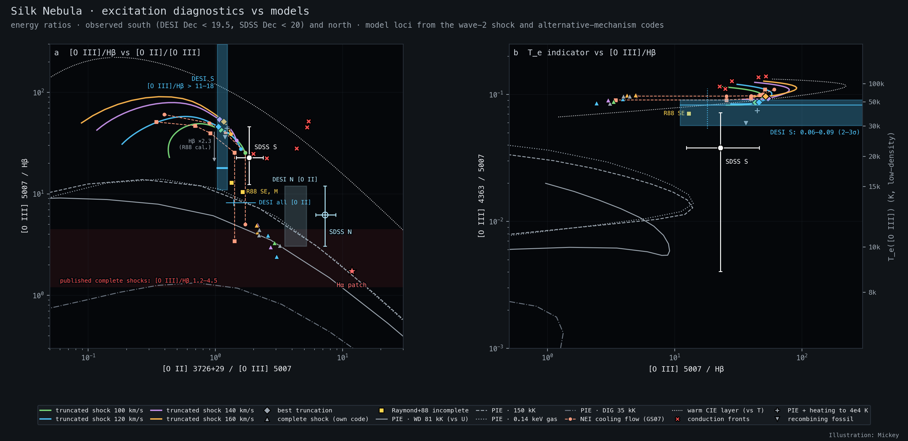

# The Silk Nebula: discovery, precovery, and a spectroscopic re-examination of its supernova-remnant verdict

*中文版：[REPORT_zh.md](REPORT_zh.md)*

*Study date 2026-11-16/17. Project folder `~/astronomy/silk-nebula`.*

All numbers come from files in this folder:
- the canonical table, `notes/w3_canon.md` and `data/derived/w3_canon_values.json`;
- the later wave-3 notes `w3_oii` and `w3_northsouth`, and the wave-4 notes `w4_*`, which supersede it where needed.

This was a multi-agent study in four waves:
1. research;
2. adversarial verification and physical modelling;
3. reconciliation, figures and a three-judge hypothesis panel;
4. close-out tests.

Where waves disagree, the later wave wins.

---

## Summary

**What it is.** The Silk Nebula is an [O III] λ5007 arc, 16.9° long and very narrow, in Gemini/Canis Minor.
- **Spine:** (RA, Dec) = (116.54°, +12.00°) → (114.36°, +28.25°); l ≈ 208°→191°, b ≈ +17.5°→+21.8°.
- **Width:** the ridge is 0.28° FWHM.
- **W strand:** a second strand branches off near Dec +15° and ends at a small Hα + [S II] patch near (115.47°, +20.54°).

**Independent discoverers.** Three teams found it independently:
- **SWONS** (Nov/Dec 2023). First public image: AstroBin, 2024-01-14.
- **Stefan Ziegenbalg's NSNS** survey (~Jan 2024). First journal paper: RNAAS 9, 227, 2025-08-28.
- **Schaeffer, Fesen and Drechsler**, who published it as the north-east limb of the Monogem Ring (arXiv:2608.26666, 2026-08-27).

The claim that Sergey Koposov found it in DESI data is second-hand. Public DESI DR1 spectra do contain it at ~30σ.

**Precovery.** The filament has been in archival data since at least 2002, about 21 years before discovery.
- **Detections:**
  - SDSS imaging sky levels in g (first ≥ 3σ run 2002-12-31);
  - SDSS sky fibres (plate 1203, 2003-01-30, confirmed by two independent analyses; first ≥ 5σ 2005-03-03);
  - BOSS/eBOSS, LAMOST LRS stellar residuals (from 2013) and DESI DR1 (2021–22).
- **UV:** GALEX shows a matching far- and near-UV filament.
- **No detection:** photographic plates (DSS/POSS) and Hα surveys (SHASSA in the south, WHAM).
- **No test possible:** Pan-STARRS stacks are blind to degree-scale emission by construction, and VTSS does not cover the spine.

**The LAMOST paper.** Wu et al. 2026 (arXiv:2610.13329, AJ 172, 298) reaches a "possible supernova remnant" verdict. That verdict rests on three numerical errors and on a misattributed diagnostic:
1. **The fiducial 160 pc is a units slip.** Table 4 lists the `kd` package's output, which is in kpc, under a "100 pc" label. The paper's own kinematic distance is therefore ~1.6 kpc. Kinematic distances are meaningless in this direction anyway.
2. **The [O III] velocity is a calibration artefact.** The published +24 to +27 km/s comes from re-referencing the blue arm to air-wavelength airglow, which undid the heliocentric correction. The paper's own Fig. 3 spectrum, measured against its [N I] airglow, gives +13.6 ± 1.2 km/s. The combined value is V_helio = +13.3 ± 1.0 km/s (V_LSR ≈ +1; ±1 km/s estimator systematic), the same as the local warm ionized medium (WIM) and HI. The north is +4–9 km/s redder, following the northern HI. So the claimed [O III]/red-line velocity offset, and everything built on it, disappears.
3. **The brightness is 4–8× too high.** Every flux-calibrated measurement gives ~1.4–2.5 R on the southern ridge, not 10–13 R.
4. **Misattributed diagnostic.** The red-arm "shock" ratios ([S II]/Hα, [N II]/Hα, BPT) are identical in the nebula-free background region P4. They describe the foreground/background WIM, not the filament. The paper's own [S II] ratios imply n_e ≈ 225–631 cm⁻³, not the quoted 64–150. The energy and age use invalid inputs.

**New spectroscopy.** We measured the filament's own spectrum in two ways:
- **DESI DR1:** 7,620 public coadds, using the residuals left after DESI's per-petal sky subtraction.
- **SDSS/BOSS/SDSS-V:** 9,092 sky-fibre spectra, using the total sky.

Results:
- **Balmer-dark:** [O III]/Hβ > 11 (2σ; SDSS ≈ 23); [O III]/Hα ≳ 3.
- **Ratios:** R23 > ~30 (2σ; DESI box > 29); [O II]3727/[O III] ≈ 1.1–1.2 in the south, rising to 4–8 in the north; He II 4686/[O III] < 0.026.
- **Temperature hint:** [O III]4363/5007 ≈ 0.06–0.09 (2–3σ), giving T_e ≈ (3–6)×10⁴ K.
- **No other counterpart:** no Hα, HI, dust or X-ray filament.

**What it probably is.**
- **Excluded by the spectrum itself:** photoionized gas, whether diffuse ionized gas (DIG), hot white dwarfs or Monogem's own EUV. Complete radiative shocks are excluded too.
- **Ruled out on physical grounds:**
  - **Conduction fronts:** their far-UV floor is too high, the width needs too much pressure, and they predict the wrong ionization order.
  - **Mixing layers and cooling of the hot gas:** both predict an X-ray filament, and none is seen.
- **Disfavoured but not excluded:**
  - **A heated warm layer, or photoionization plus extra heating:** these need an unidentified, shock-sized heat source and predict too little C IV.
  - **A hot-start fossil:** it needs heating within the last ~1.5–4×10³ yr, which is effectively a shock.
  - **C IV evidence:** the C IV level is implied by the GALEX FUV/[O III] ratio and by the digitised Kim et al. (2007) FIMS/SPEAR C IV map. The FIMS part assumes its region R1 is the Silk, a ~2σ spatial match.
- **What fits:** the cooling zone of an incompletely cooled ("column-truncated") radiative shock of ~80–150 km/s, seen edge-on as a sheet. In such a shock, gas has been heated and is radiating [O III] and [O II], but has not yet cooled far enough for hydrogen to recombine.
- **Location:** the southern spine lies at the radius of the Monogem Ring's shell, on the local outer edge of its soft-X-ray emission.
- **Panel verdict:** three independent judges favour the Monogem-limb version at ~250–320 pc (posterior 0.50–0.64). The same shock driven by a different, unidentified source gets 0.26–0.29. The paper's 160-pc, 2×10⁵¹-erg SNR gets ≤ 0.01. Wave-4 close-out tests leave P(shock) ≈ 0.9 but make the Monogem registration only modest (likelihood ratio ~4–10). The balance stays at roughly H1 0.5–0.6 against H2 ~0.3.

**Decisive next observations.**
- a far-UV spectrum (C IV doublet ratio and C IV/O III]) and the far-UV-versus-[O III] stratification;
- deep Hβ, [O III]4363 and [O II]7320–7330 spectroscopy; an R ≈ 4000–10,000 [O II] 3726/3729 doublet tests the common 2σ density tension but does not rank the scenarios;
- HST/COS C IV/Si IV absorption toward a bracket of white dwarfs at 150–600 pc;
- a two-epoch proper motion: ~60–120 mas yr⁻¹ at 282 pc (~60–90 for the preferred v_s of 80–120 km/s), zero for a static layer;
- an R ≥ 30,000 [O III] profile, which tests the sheet geometry.

*Figure 1. NSNS DR0.2 [O III] map (S. Ziegenbalg) with the traced E/W/W2 strands, the Hα patch, the paper's regions P1–P4, the LAMOST 5° plate, and Monogem eRASS1 0.2–0.6 keV contours. Yellow and violet dots mark the SDSS/BOSS sky fibres and DESI DR1 coadds used here. (`figures/w3_figs_f1_overview.png`)*

---

## 1. Discovery and characteristics

### 1.1 Timeline and credit

| Date | Event |
|---|---|
| 2002–2022 | Present in SDSS, BOSS/eBOSS, LAMOST and DESI archival data (see Figure 2, §2 and §4) |
| 2022-12 → 2024-01 | NSNS [O III] cameras start; the arc appears on "the first clear night after full configuration" (~Jan 2024; self-reported) |
| 2023-11 / 2023-12 | SWONS detection (the paper says November; a SWONS member's blog says December) |
| **2024-01-14** | **First public image**: AstroBin `zh47r9` by SWONS member Song-Yu Jia ("Huge Undiscovered [OIII] Structure", 1°×10°, no coordinates) |
| 2024-02-01 | LAMOST MRS-N plate on HIP 37797 (the paper's data) |
| 2024-06-11 | Ziegenbalg on Cloudy Nights: 14° arc, first public position, "I would say it is a supernova remnant" |
| 2024-06/07 | T. Schaeffer (NHZ): "part of the Monogem SNR" |
| 2024-07-12 | QHYCCD press note: first English use of "Silk Nebula" (1.5°×15°) |
| 2025-06-11 | NSNS catalogue entry O200.0 (16.9°×3.0°); the northern part lies outside Monogem; Geminga-SNR alternative |
| **2025-08-28** | **First journal paper**: Ziegenbalg 2025, RNAAS 9, 227 |
| 2026-08-27 | Fesen et al. arXiv:2608.26666: the 15° [O III] group is Monogem's E/N limb (does not name "Silk" or SWONS) |
| 2026-10-09 / 11-04 | Wu et al. arXiv:2610.13329 / AJ 172, 298 |

The AJ version adds an acknowledgment that the Fesen/Drechsler/Schaeffer and Ziegenbalg teams discovered the nebula independently. It keeps "discovered and named by the SWONS team" and "detected for the first time to its full extent". The Koposov/DESI attribution traces only to an AstroBin caption, `zwfplw`, reporting a conversation with V. Belokurov; no primary source exists. Details are in `notes/discovery.md`.

### 1.2 Geometry and brightness

*Figure 2. Per-epoch [O III] signal on the strand in SDSS imaging sky, SDSS/BOSS plates (placebo-included), LAMOST LRS and DESI DR1, plus the discovery and publication record. (`figures/w3_figs_f7_timeline.png`)*

**Spine (`data/derived/silk_trace.json`).** We measured 66 points, at a median σ of 0.022°, in four images registered to Tycho-2 stars:
- the paper's SWONS composite;
- its Fig. 4 background;
- the NSNS narrow and wide views.

**Length.** The spine is a 16.94° arc (16.38° chord). The quoted extents of "1°×10°", "15°" and "17°" reflect different coverage. The paper's own Fig. 1 actually spans 3.9° × 13.5°.

**Width and strands.**
- **E strand:** FWHM ≈ 0.28°, i.e. 1.4 pc at 282 pc.
- **W strand:** carries most of the [O III] at Dec 15–20 (SDSS: W 1.93 R vs E 0.73 R).
- **Envelope:** the paper's "~1° width" is the envelope of several strands.

**Curvature.** A single circle (R = 21.3°, centre (94.5°, +16.8°)) describes both halves to rms 0.12–0.19°, with no geometric break. The formal χ² is poor only because the arc wiggles on small scales. Taken alone, the southern section is straighter (R ≈ 67°) and runs tangent to the Monogem circle. The north bends west.

**[O III] brightness (adopted).** About 2 R on the southern ridge (range 1.4–2.5 R; DESI reference 1.62 R) and 0.4–0.9 R in the north.

| Measurement | [O III]5007 (rayleigh) |
|---|---|
| DESI DR1 (corrected for true fibre acceptance) | 1.62 south; 0.56–0.71 north |
| SDSS/BOSS sky fibres, total sky ON−OFF | 1.39 ± 0.10 south (W strand 1.93); plate peaks 1.6–2.5 S / 0.4–0.8 N |
| SDSS imaging sky levels (17′ scale) | 2.3–2.6 |
| NSNS DR0.2 map | ~2.0–2.2 (1′ peaks 3.0–3.6) |
| QHYCCD note (24.3 mag/arcsec²) | 3.3–6.7 |
| **Wu et al. Table 3** (23.6–23.9 mag/arcsec²) | **10–13** |

The paper's conversion arithmetic is right. No multiplicative systematic can inflate the true value 4–8×. The candidates checked were AB/Vega, filter bandwidth, the f/0.95 filter geometry and λ4959 leakage, and the f/0.95 shift would in fact bias it low. Only an additive error could: a background or flat-field error of 7–20 % of the sky, or a background aperture cleaner of faint starlight than the nebula aperture. The SWONS inputs needed to check this are not public. The GALEX FUV/[O III] ratio also rules out 10–13 R under any shock model.

*Figure 3. [O III] brightness by dataset, with the angular scale of each measurement. (`figures/w3_figs_f3_brightness.png`)*

---

## 2. Imaging precovery and multiwavelength counterparts

| Survey / band | Epoch | Result |
|---|---|---|
| **SDSS imaging sky levels (g)** | 2002-12 → 2007-02 | **Detected statistically:** ridge 2.3 ± 0.4 R from 19 core runs, 3.9σ against coherent nulls (1.4–4.6σ across estimator variants). The signal is line-like: present in g, absent in r and i. The u band shows [O II] at 4.4σ. No variability within a factor of ~2. Earliest ≥ 3σ run: 3560 on 2002-12-31 |
| **GALEX FUV / NUV** | 2003–2012 | **Detected:** a filament matching the [O III], FUV 68–92 and NUV 36–57 CU per R of [O III] (z = 8.7 and 6.5 in the south) |
| DSS1/DSS2 (POSS-I/II) | 1950s–1990s | Not detected; DSS2 J limit < 14 × NSNS (≈ 40 R, 3σ) |
| Pan-STARRS1 DR2 stacks | 2010–14 | Blind by construction: stack sky subtraction removes arcminute-scale and larger emission (it removes even the Medusa planetary nebula) |
| Legacy Surveys | — | Not reachable (NERSC host blocked through the proxy); also sky-subtracted |
| SHASSA Hα | 1997–2000 | No Hα: 2σ < 0.77 R on the southern spine (Dec 12–15.6; the only arcminute Hα coverage) |
| WHAM-SS Hα / Finkbeiner 2003 | 1997–2003 | WIM at V_LSR ≈ 0, 2.6–4.4 R, identical on and off the filament. F03 is WHAM-only (1°) along 76 % of the spine |
| VTSS | — | No coverage |
| eRASS1 DR1 / ROSAT soft X-ray | 1990, 2019–20 | **No X-ray filament.** The south lies ~1° outside the Monogem 0.2–0.6 keV ring peak, on its outer flank; inside is brighter than outside (W/E ≈ 1.25). This bulk contrast is generic to the shell at that radius (p = 0.37 against rotations about the pulsar). In the Silk's own position-angle sector, however, the southern spine sits on the local outer half-maximum edge for all three proposed Monogem centres (+0.19, +0.08, −0.06°; rotation p ≈ 0.03–0.05) |
| FIMS/SPEAR far-UV spectral map (Kim et al. 2007) | 2003-12 → 2004-01 | C IV region "R1" (8.7 ± 0.9 ×10³ LU) lies along the southern Silk: placebo p ≈ 0.02, chosen a posteriori, so ~2σ; beam-limited. It implies C IV/[O III] ≈ 0.15–0.4 photons. Caveats: the map was digitised from a published colour image, and the ratio assumes the whole R1 excess is the Silk |
| GALFA-HI / LAB / HI4PI | — | No HI filament, wall, cavity or velocity signature (2σ < 1–1.75×10¹⁹ cm⁻² per 2 km/s slice). The wave-1 "HI wall" was an artefact of the edge-finding method |
| IRIS / Planck / SFD dust | — | No counterpart (ΔE(B−V) < 0.004) |
| Haslam 408 MHz, WMAP, Planck, Stockert 1.4 GHz | — | No total-intensity counterpart (Σ₁GHz < 1.3×10⁻²² W m⁻² Hz⁻¹ sr⁻¹); a Stockert +19.5 mK feature is ambiguous. NVSS/TGSS resolve the filament out, so the paper's radio non-detection says nothing |
| NVSS rotation measures | — | A +36 rad m⁻² step across the northern half exists, but placement nulls give p = 0.18: not filament-specific |
| Fermi-LAT | — | Nothing |
| Amateur archives (AstroBin) | ≤ 2023-11 | No public narrowband image covering the ridge before Nov 2023 |

*Figure 4. Profiles across the southern spine. [O III] (NSNS, DESI) and GALEX FUV/NUV show the same narrow ridge. SHASSA Hα, GALFA HI, IRIS 100 µm and eRASS1 X-rays show none; the X-ray gradient matches rotations about PSR B0656+14. (`figures/w3_figs_f6_profiles.png`)*

---

## 3. The LAMOST paper and its supernova-remnant verdict

### 3.1 What the paper did

Wu et al. observed one LAMOST MRS-N plate centred on HIP 37797 (2024-02-01, 3 × 900 s, R ≈ 7500), giving 2,684 usable spectra.
- **Coverage:** blue arm 4950–5350 Å, containing [O III] but **no Hβ**; red arm 6300–6800 Å.
- **Approach:** they compared the bright regions P1–P3 with a background region, P4.
- **Conclusion:** a "possible SNR" at a kinematic distance of ~160 pc, 28 pc long, with E ≈ 2×10⁵¹ erg and an age of ~6.8×10⁴ yr. DIG or an ionized bubble "cannot be ruled out".
- **Data availability:** the MRS-N nebular spectra are **not public**. DR12 holds only the plate's 83 star spectra, and the same group states the fibres are unreleased (arXiv:2510.08950). So the per-fibre lines could not be re-measured.

### 3.2 Claim-by-claim verdict

| Paper claim | Verdict | Evidence |
|---|---|---|
| Distance ~160 pc ("Table 4 in units of 100 pc") | **Wrong: unit slip** | Our Reid+14 rotation curve gives 1.785 / 1.743 / 1.154 kpc for P1/P2/P3 (printed 1.79 / 1.85 / 1.20). χ² is 0.05 if the column is kpc and 28.9 (p = 2×10⁻⁶) if it is ×100 pc. The Monte-Carlo lower bounds sit at `kd`'s 0.01-kpc grid floor. The `kd` source documents kpc throughout. The AJ text is unchanged and Crossref lists no erratum |
| A kinematic distance is usable | **Wrong** | The rotation gradient is 7.4–9.5 km/s/kpc, so ±7 km/s of peculiar motion means ±0.8–0.9 kpc. With the corrected V_LSR ≈ +1 the "distance" is 0–0.2 kpc |
| [O III] V_helio +23.8…+26.8, 10–16 km/s off the red lines ("two shell layers") | **Wrong: artefact** | The paper's Fig. 3 is stored as vector data. On its plotted scale the [N I] 5198/5200 airglow sits at its air rest wavelengths: the blue arm was re-referenced to air airglow, removing the −8.3 km/s heliocentric correction plus a 1.8 km/s offset. Correction **−10.1 ± 1.0 km/s**; [O III] against the spectrum's own airglow is **+13.6 ± 1.2**; [O III] − [N II] = +1.1 ± 1.0 km/s. LAMOST stellar blue- and red-arm velocities agree with each other and with Gaia, so the arc-lamp calibration is fine |
| LAMOST Hα +16…+20 km/s | **Plausibly an artefact (model only)** | Hα − [N II] = +5.5 ± 1.1 km/s (4.9σ) and Hα − WHAM = +4.8 ± 0.7, while [N II] agrees with WHAM. On this plate the geocoronal line lies within one resolution element of the nebular line and is about as bright. A forward model with ~30 % over-subtraction explains one-half to three-quarters of the offset when the line widths are fitted too (model only; `DISPUTE.md` §4) |
| Surface brightness 10–13 R | **~4–8× too high** | See §1.2 |
| [S II]/Hα > 0.4, [N II]/Hα, BPT/SMB ⇒ shock | **Misattributed** | The same ratios hold in nebula-free P4 (\|Δ\| ≤ 0.6σ) and match faint high-latitude WIM (WHAM, Madsen+06). The red lines are foreground/background WIM, and the criterion would classify the background as "shocked" too |
| n_e ≈ 64–150 cm⁻³ from [S II] | **Wrong** | The paper's own Table 2 ratios (1.03–1.19) give **225–631 cm⁻³** with a 5-level S⁺ atom (169–400 with its eq. 5). Neither number describes the [O III] gas, which needs n_e ~0.1–3 at its brightness |
| T_e ~9000–10⁴ K, V_t 29–33 km/s, near-solar O/H | **Uninformative** | Line-width temperatures have σ_T ≈ 7,300–10,600 K, with P(T < 0) = 17–38 %. N2/N2S2Hα are H II-region calibrations applied outside their validity range (eq. 6 is the linear Pettini & Pagel relation, not "third-order"). P4 gives the same values: these describe the WIM |
| Intrinsic [O III] FWHM 43–49 km/s | **Not measured** | At S/N ≈ 6 with the paper's width cut, fits return ~36–47 km/s for any true width |
| V_s 119 km/s, E 2×10⁵¹ erg, R_PDS 18 pc, age 6.8×10⁴ yr | **Arithmetic OK, inputs invalid** | E = 2.01×10⁵¹ reproduces, but R_PDS is 17.1 pc. The printed age formula has a "+1" typo for "+1/3", and the age recomputes to 7.95×10⁴ yr; 6.8×10⁴ needs the rounded R_PDS = 18 pc. The inputs are wrong: 160 pc, an assumed n₀ = 1, V_s from the WIM [S II] density, and 10 R. The Hβ upper limit bounds any complete (Balmer-emitting) shock at 280 pc to n₀ ≤ 0.002–0.034 and E ≤ 1.4×10⁴⁹–2.9×10⁵⁰ erg |
| No NVSS/TGSS radio ⇒ old SNR | **Uninformative** | Interferometers resolve out a 17′-wide filament |
| Part of Monogem (via Fesen) while at 160 pc | **Internally inconsistent** | Monogem is at ~288–300 pc |
| [O III] filament detected along the structure, absent in P4 | **Right** | Confirmed by DESI, SDSS fibres, SDSS imaging and NSNS |
| Red lines are DIG/WIM | **Right (for the red lines)** | WHAM identical on and off the filament |
| "Possible SNR / shock" | **Defensible, for different reasons** | See §5 |

The paper review listed 18 internal inconsistencies, such as a Section 3.4 "expansion speed ~140 km/s" that does not exist. The geometry analysis found more:
- Table 1 P1/P4 positions lie 0.42–0.48° from the outlines drawn in Fig. 1b.
- Fig. 4 plots 173 [O III] fibres, against "279" in the text.

Details are in `notes/paper_review.md`, `notes/verify_paper.md` and `notes/verify_velocity.md`.

*Figure 5. Heliocentric velocities. Table 4's [O III] (red) sits ~10 km/s above every other measurement. Corrected, and re-measured against the paper's own airglow, it joins DESI, SDSS, the LAMOST [N II]/[S II], WHAM Hα and local HI at +13.3 ± 1.0 km/s. (`figures/w3_figs_f2_velocity.png`)*

---

## 4. New spectra: DESI DR1, SDSS/BOSS/SDSS-V and LAMOST LRS

### 4.1 Methods

**DESI DR1** (public; spectra via NOIRLab SPARCL, catalogues via Data Lab TAP).
- **Principle:** DESI subtracts a mean sky per petal. A smooth nebula is removed, but structure on scales below a petal leaves positive residuals on the filament and negative residuals nearby.
- **Data:** 7,620 galaxy/QSO coadds in a strip around the trace plus controls. Only ±40 Å line windows were kept.
- **Analysis:** a petal forward model and template regressions on [O III] give the filament's own line ratios, free of the smooth DIG.
- **Calibration:** a wave-1 error in the fibre-acceptance factor (the Legacy-Surveys normalisation was used instead of the guide-camera (GFA) acceptance) was found and corrected (×0.736).
- **Not available:** DESI sky fibres and per-petal sky models live at NERSC (`data.desi.lbl.gov`), which this machine cannot reach.

**SDSS-I/II, BOSS/eBOSS and SDSS-V DR19 sky fibres.**
- **Data:** 9,092 spectra in 256 plate–spectrograph groups.
- **Principle:** Galactic [O III] and Hβ have no significant airglow, so the total sky spectrum (residual + sky model) measures the nebula absolutely.
- **Analysis:** ON−OFF stacks within each plate; zero points from [O I]5577; diffuse-light correction tied to the imaging sky. A wave-1 error (using the pipeline residual, whose fibre-dependent sky model absorbs ~40–50 % of the signal) was corrected.

**LAMOST LRS DR12** stellar residual stacks (2,500 ON / 1,500 OFF stars) give an independent detection: [O III] 0.88 ± 0.13 R, with no Hβ. This is a wave-1 value that was not re-verified. It averages over |d| < 0.2° and Dec 12–28, so it is diluted relative to the ridge values.

### 4.2 Results

**Detection.** DESI traces the filament on its own from Dec +14 to +28 at ~30σ against empirical nulls. The detection holds in every Dec band, programme, target class and tile/HEALPix jackknife. SDSS sky fibres detect it along its whole length.

**Velocity.**
- **All data:** V_helio = **+13.3 ± 1.0 km/s** (V_LSR +1.2 ± 1.0; ±1 km/s estimator systematic), from DESI, SDSS and the paper's Fig. 3a.
- **E vs W strand:** no significant difference.
- **North vs south:** the north is +4 to +9 km/s redder (ΔV_LSR +7 to +11).
  - This is DESI only, estimator-dependent, and 2–3.5σ per estimator. DESI and SDSS disagree at Dec 17.6–21.
  - The northern HI component (V_LSR +8.5…+11.3) is at a similar velocity; treating it as the pre-shock gas is an assumption.

**Line ratios of the filament** (energy ratios; south unless stated):

| Ratio | DESI DR1 | SDSS/BOSS | Adopted |
|---|---|---|---|
| [O III]5007/Hβ | > 11 (box) / > 18 (Gaussian), 2σ | ≈ 23 (13–48); > 5–7.5 at 2σ with placebo systematics | **> 11 (2σ); plausibly 15–25** |
| R23 | > 29–34 (2σ) | ≈ 76 (> 20) | **> ~30** |
| [O II]3727/[O III] | 1.11–1.16 (Dec < 19.5) | 1.17 (Dec < 17.6) | **≈ 1.1–1.2 south → 4–8 north** |
| He II 4686/[O III] | < 0.026 (97.5 %) | < 0.04 | **< 0.026** |
| [O III]4363/5007 | 0.06–0.09 (2–3σ); line at 4364.6–4364.7 Å, so the Hg I 4358 street-lamp line is excluded | not constraining | **hint; T_e ≈ (3–6)×10⁴ K** |
| [O II]7320+7330/3727 | 0.060 (0.055–0.073; south 0.064), ±0.015 OH systematic, after fixing a ×1.8 normalisation bug | — | **T(O II) ≈ (2.4–5.5)×10⁴ K** |
| [O II]3729/3726 | 1.31 ± 0.07 (2σ from the low-density limit) | instrumental (blended doublet, blue-end calibration) | **inconclusive** |
| [Ne III]3869/[O III] | 0.07–0.10 | — | measurement (low confidence) |
| [N II]/Hα, [S II]/Hα | ~1.0–1.2, 0.5–0.75 | 0.7, 0.6 (south) | **systematics-limited (×2)** |
| [O III]/Hα | > 3.4 (direct) | > 3.0 (Dec < 17.6, placebo) | **≳ 3 (photon, 2σ)** |

**North and the Hα patch.**
- **Northern arc:** fainter, with lower [O III]/Hβ (~7) and higher [O II]/[O III] (4–8): a lower-excitation spectrum.
- **Hα patch:** has a shock-like low-ionization spectrum: [S II]/Hα ≈ 1.06, [N II]/Hα ≈ 0.78, [O II]/Hβ ≈ 13 and an unreddened case-B Balmer decrement. It lies 0.35° from the Planck cold clump PGCC G199.09+19.95 (CNM at V_LSR −0.7 and +6.5 km/s).

*Figure 6. The filament's own spectrum (DESI regression and SDSS/BOSS total-sky ON−OFF), normalised to [O III]5007: [O II] as strong as [O III], weak Hβ (the reference curves show [O III]/Hβ = 3 and 11), and [O III]4363 at the [O III] wavelength rather than at Hg I. The SDSS [O II] panel uses the wave-2 BOSS stack, which gives [O II]/[O III] ≈ 1.8. The current southern value is 1.17 at Dec < 17.6 (see §4.2). (`figures/w3_figs_f4_spectra.png`)*

---

## 5. Interpretation: chemical and dynamical clues, and a revised hypothesis

### 5.1 What the spectrum rules out

*Figure 7. Observed ratios against model loci: truncated-shock tracks (100–160 km/s), complete shocks, photoionization at any ionization parameter (hot white dwarf, 150 kK, 0.14 keV gas, DIG), cooling flows, warm-CIE layers, conduction fronts and fossil gas. Two caveats: the shock tracks are the wave-2 runs (100–160 km/s, fitted before the withdrawn [O III]/Hβ ≈ 46 was corrected), and the SDSS-south point shows the superseded [O II]/[O III] = 1.84. The wave-4 refit prefers v_s ≈ 80–120 km/s. (`figures/w3_figs_f5_diagnostics.png`)*

Wave 4 refitted every scenario with the corrected inputs (`notes/w4_refit.md`). Two levels of exclusion emerge.

**Excluded by the spectrum itself**
- **Photoionized gas.** This covers DIG, an "ionized bubble", hot white dwarfs and the EUV of Monogem or the Local Bubble. The fit gives χ² of 21–51 for 8 terms (p ≤ 0.02).
  - Photoionized gas reaches only [O III]/Hβ ≲ 10–14 and 4363/5007 ≲ 0.012–0.034, and DIG reaches [O III]/Hβ ≤ 1.3.
  - He II/[O III] would be 0.06 for a hot-gas spectrum, against < 0.026 observed.
  - Independently, the ionization parameter falls short by 18–30× to 10⁴× even for the best catalogued source, the 81 kK DOZ white dwarf WD J0736+1444 at 150 pc.
- **Complete radiative shocks.** χ² ≥ 37.
  - They reach only [O III]/Hβ ≤ 5 (own code 2.4–5.0; published grids 1.2–4.5).
  - They would produce an Hα filament and cooled HI, neither of which is seen.
  - The GALEX FUV level is below their non-resonant line floor.

**Spectrally acceptable but physically excluded or disfavoured**
- **Turbulent mixing layers and non-equilibrium cooling of Monogem's hot gas.** Both predict a soft-X-ray filament 10³–10⁴× brighter than Monogem, and none is seen. A mixing layer would also need a near-transonic inflow: ~380 km/s at limb gain G ≈ 19, and still ~140 km/s at G = 50.
- **Conduction fronts.** Their non-resonant FUV floor (179–213 CU/R) is too high, the 1.4-pc width needs P/k ~10⁶, and they predict C IV/[O III] 1.6–16 against FIMS 0.15–0.4.
- **A statically heated ~6×10⁴ K warm layer: disfavoured, not excluded.** It fits the optical ratios (χ² 6/9). It needs an unidentified, shock-sized heating flux (0.5–2.6×10⁻⁵ erg cm⁻² s⁻¹) at a thermally unstable temperature. It predicts too little C IV (4–10× below the FIMS-implied level) and no far-UV/[O III] offset. The judges' ~5 % share for it should stand until a far-UV spectrum, Hβ depth or proper motion is measured.
- **Photoionization plus extra heating: disfavoured.** It needs 78–350× the photo-heating and an ionizing source that does not exist.
- **A hot-start fossil: disfavoured.** It needs a heating event within the last ~1.5–4×10³ yr, which is itself a shock.

### 5.2 What fits

The spectrum is that of collisionally heated gas, at roughly 3–6×10⁴ K, whose hydrogen has not yet recombined:
- Balmer-dark;
- [O II] about as strong as [O III];
- weak He II;
- a 4363 temperature hint;
- far- and near-UV line emission.

A **column-truncated (incomplete) radiative shock** reproduces all of it. The model is our own non-equilibrium shock code, validated against published grids, and refitted with the corrected inputs (`notes/verify_shockmodel.md`, `notes/w4_refit.md`).
- **Fit quality:** best χ² 0.3 for 10 terms; 279 of 480 runs acceptable.
- **Shock:** v_s ≥ 80 km/s. With the full far-UV line budget, ~80–120 km/s is preferred (≲ 150).
- **Truncation:** log N* ≈ 17.4–18.7 cm⁻², i.e. the cut falls before hydrogen recombines, at T* ≈ 1–3×10⁴ K.
- **Predicted ratios:** [O III]/Hβ 13–62; [O II]/[O III] 1.0–1.8; 4363/5007 0.08–0.10; [O II]7325/[O III] 0.06–0.12.
- **Geometry:**
  - A smooth curved 58-pc limb is disfavoured at about 2σ (p ≈ 0.04–0.09), not excluded. It predicts a lopsided cross-profile (σ_W/σ_E ≈ 2–6), whereas the southern profile is nearly symmetric: 1.07 (1.00–1.16), with ±0.17 real-sky scatter. This shape does not separate H1 from H2.
  - An **edge-on flat or gently curved/rippled sheet** works (line-of-sight sagitta ≲ depth, limb gain ≲ 15): pre-shock n₀ ≈ 0.01–0.13 cm⁻³ (median 0.024), ram pressure P/k ≈ 1×10⁴–5×10⁵ (median 5.5×10⁴ K cm⁻³, ∝ 1/d), and a line-of-sight depth of 3.5–59 pc.
  - The pressure is comparable to Monogem's interior, but in this geometry the "pressure match" is no longer independent evidence: the brightness sets only the depth.
- **Line width:** FWHM ≈ 11–13 km/s (thermal) for a flat edge-on sheet, with the centroid at the pre-shock gas velocity. A 5–10° tilt shifts the centroid by 5–19 km/s without broadening it; only a rippled sheet gives 20–50 km/s.
- **Timescale:** the shock has run for 2–11×10⁴ yr, less than its cooling time, so truncation is natural.
- **UV:**
  - **GALEX:** the FUV ratio (68–92 CU per R; ≈ 85–115 on the DESI scale) matches if C IV is suppressed ~5×. Edge-on resonance scattering in the sheet does this (effective transmission 0.12–0.57; model 68–143 CU/R).
  - **FIMS:** the flat-sheet model predicts C IV/[O III] ≈ 0.04–0.18 photons. The digitised FIMS map implies 0.15–0.4, at or above the top of that range, if its R1 excess is the Silk; that implies ~2.5–9× suppression.
  - **Stratification:** the model predicts the FUV ridge leads [O III] by +0.04…+0.10° on the outward side. GALEX shows only an eastward FUV wing (template shift +0.067°, p ≈ 0.09), while the FUV peak stays on the [O III] ridge. This mildly favours the shock sign (likelihood ratio ~4–14) and is not a detection.

This is the same physics as the incomplete-shock [O III] filaments of the Cygnus Loop (Raymond et al. 1988), but at ~35–370× lower pre-shock density (median ~180×).

**Remaining tensions.** Neither is decisive:
- The DESI [O II] ridge lies slightly *east* of [O III] (+0.04–0.05°). A 1-D shock predicts the opposite, which is disfavoured at p ≈ 0.003–0.07. Two components or a WIM/petal systematic could explain it.
- DESI's [O II] 3729/3726 = 1.31 ± 0.07 sits 2.1–2.7σ from the low-density value 1.46 that every low-density scenario predicts.

### 5.3 The dynamical clues

- **Velocity equals the local gas.** The [O III] moves with the WIM, the local HI and local Ca II/Na I (V_LSR ≈ 0–2 km/s). For an edge-on shock seen at its tangent point, the line-of-sight velocity is the pre-shock gas velocity. The expansion is in the plane of the sky.
- **No systematic splitting.** The paper's 10–16 km/s split between [O III] and the red lines ([N II]/[S II]), and the "two shell layers" built on it, came from the calibration slip.
- **The north.** It is +4–9 km/s redder (estimator-dependent), fainter and lower in excitation.
  - **Shock speed:** this fits a slower shock (~60–110 km/s, median ~80). Only the product of pressure and limb gain is constrained, at 0.1–3.3× the southern value.
  - **Origin of the redshift:** redder pre-shock gas (HI at V_LSR +8.5…+11, association assumed), a 3–10° tilt, or a one-sided chord. A single expanding sphere seen on its far side does not explain it.
  - **Hα/[S II] patch:** it looks like a local shock–cloud interaction where the shock has fully cooled. That reading is qualitative. The adjacent cold clump is hinted to lie at ≳ 400 pc (catalogue 262 ± 121 pc), so the adjacency may be a projection.
- **Profile shape.**
  - **North:** robustly one-sided (σ_W/σ_E = 2.28 against 1.01 ± 0.08 for a symmetric null, p ≈ 0.02), with a sharp eastern edge and the concave side to the west. A limb or a one-sided chord fits; a flat ribbon does not.
  - **South:** nearly symmetric (1.07). That fits a flatter sheet touched by the blast wave better than a smooth curved limb, which is disfavoured at ~2σ.

### 5.4 The chemical clues

No abundance anomaly can be claimed. In a non-equilibrium shock, strong-line abundance indices (N2, N2S2Hα, R23 calibrations) are invalid, and the paper's "near-solar O/H" describes the WIM. The model fits use solar abundances throughout. Within the stated systematics, nothing requires enrichment (as in planetary-nebula or Wolf–Rayet ejecta) or depletion:
- [Ne III]/[O III] ≈ 0.07–0.10;
- He I 5876 < 0.005;
- [N II]/Hα ~1, systematics-limited.

The diagnostic content is **thermal and ionization structure** (Balmer darkness, R23, T_e), not composition.

### 5.5 Where is it, and what drives it?

**Distance.** If the southern spine is the Monogem limb, the distance is **252–318 pc (68 %; median 282)**. That rests on the spine lying 12.10 ± 0.12° from the Knies et al. (2024) two-remnant centre, which matches Monogem's radius; PSR B0656+14 is at 288 pc. Nothing measures the distance directly:
- no absorption line brackets the ionized gas;
- there is no dust;
- the kinematics are uninformative.

Anything from ~100 pc to ~1 kpc is allowed. 160 pc (on the Local Bubble wall at 161–171 pc) is not excluded by measurement. ~1.6 kpc is disfavoured: the filament would be 470 pc long at z ≈ 0.55 kpc, and the north–south velocity gradient has the opposite sign to Galactic rotation.

**Hypothesis panel** (`notes/w3_judge_{obs,phys,skeptic}.md`). Three independent judges scored each hypothesis, each through a different lens:

| Hypothesis | Observational | Physical consistency | Devil's advocate |
|---|---|---|---|
| H1 Incomplete radiative shock on Monogem's outer limb, ~250–320 pc | 0.50 | 0.64 | 0.60 |
| H2 Same kind of shock, different or unknown driver (older SNR, G205.6+12.4, Local Bubble wall, Geminga fragment) | 0.29 | 0.26 | 0.27 |
| H3 The paper's model: independent SNR at 160 pc, 2×10⁵¹ erg, 6.8×10⁴ yr | 0.01 | 0.005 | 0.005 |
| H4 Superbubble wall at 1–2 kpc | 0.04 | 0.04 | 0.035 |
| H5 DIG / photoionized bubble wall | 0.02 | 0.01 | 0.01 |
| Other / unknown: conduction, mixing, cooling flow, heated warm layer, fossil, unanticipated mechanisms (the judges grouped these differently) | 0.14 | 0.045* | 0.08 |

\*The physical-consistency judge's 0.045 includes 0.008 for two shock mechanisms it added: a runaway-star or pulsar bow shock, and an infalling high-velocity-cloud shock.

All three put P(shock-heated, any driver) at ≈ 0.84–0.95. The weakest links they identified:
- **Distance:** the Monogem association rests mainly on one geometric coincidence. The judges estimated its chance probability at p ≈ 0.03–0.07, a Bayes factor of ~10–20 after look-elsewhere. Wave 4 supersedes these values: P ≈ 0.09, likelihood ratio ~4–10.
- **Inputs:** several diagnostics (4363, the [O II] doublet, the Hβ central value) are at 2–3σ.
- **C IV suppression:** the factor (~5×) is model-dependent.
- **Line width:** the [O III] width has never been measured at sufficient resolution.

**Close-out tests (wave 4)**
- **Chance coincidence, recomputed with one defined null.** Placing the rigid trace at random in the same latitude band, the chance of matching a Monogem radius, given that the trace reaches a rim, is 0.09. That is a likelihood ratio of only ~4–10, not the 60–120 one judge computed. In the Silk's own sector the southern spine sits on the eRASS1 outer half-maximum edge for every proposed centre, which removes the "works only for one centre" objection.
- **The cold clump next to the Hα patch** (PGCC G199.09+19.95) appears to lie at ~400–650 pc (a ~2–2.5σ stellar-extinction hint), not at 250–320 pc. Two caveats: the PGCC catalogue gives 262 ± 121 pc, and the 3D dust map does not resolve the clump. The 3D dust maps show no layer at 250–320 pc along the ridge. This weakens H1's "second coincidence", the patch lying on the Monogem radius.
- **Monogem family.** Of the other Monogem [O III] filaments, only Fesen's faint eastern filament "E1" had usable DESI spectra. It is Balmer-faint and [O II]-strong, like the Silk north. Its V_LSR is −24 km/s, so the eastern filaments do not share one tangential velocity. This neither confirms nor refutes H1. The decisive analogue, the southern Monogem limb "S1" on the same circle, has no usable public spectra.
- **Far-UV.** The Kim et al. (2007) FIMS/SPEAR C IV region R1 lies along the southern Silk. This modestly strengthens a C IV-suppressed shock over a warm layer or conduction fronts.

**Net.** P(shock-heated, any driver) ≈ 0.9 (unchanged or slightly higher). The Monogem attribution stays favoured but on thinner evidence: H1 ≈ 0.5–0.6, H2 ≈ 0.3. The distance is not measured.

---

## 6. Decisive future observations

1. **Far-UV spectroscopy** (the FIMS/SPEAR archive along the Silk, or a future UV mission) separates shock from static gas, independent of distance:
   - **Truncated (flat-sheet) shock:** C IV is optically thick in the sheet, so the 1548/1551 doublet ratio is ~1.0–1.3, with a predicted C IV/[O III] ≈ 0.04–0.18 photons. The digitised FIMS map implies 0.15–0.4.
   - **Warm layer:** doublet ratio ≈ 2, with C IV/[O III] ≈ 0.03–0.04.
   - **Conduction fronts:** C IV/[O III] ≳ 1.6.
2. **Deep long-slit or IFU spectroscopy at R ≈ 4000–10,000** on the bright southern strand, covering Hβ, [O III]4363, He II 4686, [O II]7320–7330 (needing OH-clean sky subtraction, ±0.007) and the resolved [O II] 3726/3729 doublet. It would settle the T_e question. The doublet tests the common 2σ density tension but does not rank the scenarios, since all predict ≈ 1.46. In the table, the warm-layer column also lists the photoionization-plus-heating variant, which overlaps the shock in Hβ and 4363.

| Line ratio | Truncated shock | Warm layer |
|---|---|---|
| [O III]/Hβ | 17–61 | ~97 (photoionization + heating: ~45) |
| 4363/5007 | 0.082–0.091 | ~0.098 (photoionization + heating: ~0.075) |
| [O II]7325/3727 | 0.056–0.067 | ~0.082 |
| [O II] doublet | ≈ 1.46 | ≈ 1.46 |

3. **Two-epoch [O III] proper motion.** Expected at 282 pc: ~60–90 mas yr⁻¹ for the preferred v_s of 80–120 km/s (60–120 for all flat-sheet survivors; 75–112 if v_s = 100–150). Expected at other distances: about 1.8× larger at 160 pc and 3.5× smaller at 1 kpc. Zero for any static layer.
   - **Epoch 1:** the raw SWONS ε-180ED + QHY600 frames from Jan 2024 (1.55″/px).
   - **Epoch 1b:** ≤ 1″/px imaging in 2026–27 on the south core (Dec 13–16), the junction (Dec 17–19) and the sharp northern edge (Dec 21–26).
   - **Epoch 2:** 2034–36.
   - **Precision:** detecting motion at 282 pc within 10–12 yr needs a per-epoch edge precision of ≲ 0.1–0.15″.
   - **Distance:** with a shock velocity from the Hβ depth or the far-UV spectrum, d = v_s / (4.74 μ). A line width measures v_s only in a rippled or curved geometry.
4. **HST/COS high-ion absorption bracket** (C IV, Si IV). `notes/w4_distance.md` lists 52 hot stars within 0.3° of the ridge at 120–800 pc. None has archival UV spectra; 18 reach S/N 15 at C IV in ≤ 5 orbits.
   - **Recommended white dwarfs:** 154, 234 (DA 29.7 kK), 294, 389, 445 and 594 (DO 84 kK) pc in the south; 407 and 588 pc in the north.
   - **Prediction under H1:** Silk-velocity C IV appears only beyond ~250–320 pc.
   - **Quick archival step:** analyse the existing COS G130M spectrum of QSO 2MASS J07452815+1919525, 0.34° from the W strand.
5. **Spectroscopy of the southern Monogem limb "S1"** (e.g. (106.0°, +3.47°), (112.5°, +4.05°)). It lies on the same circle as the southern Silk. H1 predicts the same Balmer-dark spectrum at V_LSR ≈ 0 ± 5 km/s.
6. **An R ≥ 30,000 [O III] profile.** A flat edge-on sheet gives ~11–13 km/s (thermal) with a possible 5–19 km/s centroid shift if tilted; a rippled or curved sheet gives 20–50 km/s.
7. **Deeper eROSITA/XMM spectroscopy** of the X-ray-bright side: the interior pressure profile and the local edge in the Silk sector.
8. **Public LAMOST MRS-N fibre spectra** of the 2024-02-01 plate would allow a per-fibre check of the −10.1 km/s velocity correction.

---

## 7. Data access, limitations, and reproducibility

**Not reachable or not public**
- NERSC hosts (`data.desi.lbl.gov`, `legacysurvey.org`) are unreachable through this machine's proxy. DESI sky fibres, per-petal sky models and Legacy Surveys images were therefore not used. DESI spectra came via NOIRLab SPARCL, which ran at ~1 spectrum/s.
- `cdsarc.cds.unistra.fr` was unreachable; the VizieR mirrors were used instead.
- LAMOST MRS-N nebular fibres are unpublished.
- SWONS photometric inputs (filter curve, apertures, zero points) are unpublished.

**Measurement limits**
- Several key ratios are at the 2–3σ level. DESI's template-correlated systematic floor is ~0.05 of [O III], so DESI ratios below that are upper limits.
- The absolute [O III] scale differs by 1.5 ± 0.25 between SDSS imaging and DESI (C3 in `notes/w3_canon.md`).
- `notes/w3_canon.md` §12–13 lists 15 inter-agent conflicts and 20 file-level inconsistencies. Several conflicts were later resolved or revised by `w3_oii` and `w3_northsouth` (C2, C5, C6, C8). Its superseded-value register (§15) predates the wave-3/4 corrections.

**Errors caught and corrected during the study**
- the DESI fibre-acceptance factor;
- the SDSS residual-vs-total-sky choice;
- the [O II]7325 doublet normalisation (×1.8);
- the X-ray "edge" significance;
- the HI-wall artefact;
- a withdrawn first-pass [O III]/Hβ ≈ 47;
- stale catalogue values for PSR J0751+1807.

The register of superseded values is `notes/w3_canon.md` §15.

**Layout**

| Path | Contents |
|---|---|
| `notes/` | Per-topic notes: wave 1 `discovery`, `paper_review`, `geometry`, `context`, `imaging_optical`, `imaging_mw`, `spectra_desi`, `spectra_sdss_lamost`, `spectra_ism`; wave 2 `verify_*`; wave 3 `w3_*`; wave 4 `w4_*` |
| `figures/` | All figures. Composite report figures: `w3_figs_f1…f7` |
| `scripts/` | All analysis code (run with `~/.venvs/astro313/bin/python -I scripts/<name>.py`). Shared helpers: `silk_geometry.py`, `silk_style.py` |
| `data/raw/` | Downloads, one folder per source |
| `data/derived/` | Measurements; `silk_trace.json`; `w3_canon_values.json`; per-wave agent results `wave{1,2,3,4}_agent_results.json` |
| `sources/` | The paper (PDF, text, HTML) and web captures |

## Sources

- Wu et al. 2026, "The Silk Nebula: A Newly Discovered Giant [O III] Emission Filament", [arXiv:2610.13329](https://arxiv.org/abs/2610.13329); AJ 172, 298, [doi:10.3847/1538-3881/aeb11c](https://doi.org/10.3847/1538-3881/aeb11c)
- Fesen et al. 2026, [arXiv:2608.26666](https://arxiv.org/abs/2608.26666) (Monogem optical filaments)
- Ziegenbalg 2025, RNAAS 9, 227, [doi:10.3847/2515-5172/adfec7](https://doi.org/10.3847/2515-5172/adfec7); NSNS page [simg.de/nebulae3/gem-01.html](https://simg.de/nebulae3/gem-01.html)
- [QHYCCD press note, 2024-07-12](https://www.qhyccd.com/silk-nebula-discovered-by-enthusiast-astronomers-with-qhyccd-cameras/); [AstroBin forum topic 126958](https://app.astrobin.com/forum/topic/126958/silk-nebula-discovered-by-enthusiast-astronomers-with-qhyccd-cameras); [AstroBin zwfplw](https://app.astrobin.com/i/zwfplw)
- Kim et al. 2007, ApJ 665, L139 (FIMS/SPEAR far-UV emission of the Monogem Ring)
- Edenhofer et al. 2024 (3D dust); O'Neill et al. 2024 (Local Bubble wall); Planck Collaboration 2016, XXVIII (PGCC catalogue); Anders et al. 2022 (StarHorse); Gentile Fusillo et al. 2021 (Gaia white dwarfs); Culpan et al. 2022 (hot subdwarfs); Madsen et al. 2006 (WIM line ratios)
- Raymond et al. 1988 (Cygnus Loop incomplete shocks)
- Knies et al. 2024 (eROSITA Monogem), [arXiv:2401.17289](https://arxiv.org/abs/2401.17289); Saydjari et al. 2026 (DESI sky fibres), [arXiv:2608.28740](https://arxiv.org/abs/2608.28740); LAMOST MRS-N release status, [arXiv:2510.08950](https://arxiv.org/abs/2510.08950)
- Public data:
  - DESI DR1 via [NOIRLab Data Lab / SPARCL](https://datalab.noirlab.edu);
  - SDSS DR17/DR18/DR19 ([SAS](https://data.sdss.org/sas/dr17/), [DR19](https://data.sdss5.org));
  - LAMOST DR12 ([lamost.org](https://www.lamost.org));
  - [eROSITA DR1](https://erosita.mpe.mpg.de/dr1/);
  - GALEX (MAST);
  - SkyView (DSS, SHASSA, RASS, IRIS, Haslam, NVSS);
  - [LAMBDA](https://lambda.gsfc.nasa.gov) (Finkbeiner Hα, WMAP/Planck);
  - WHAM-SS DR1;
  - GALFA-HI DR2;
  - NSNS DR0.2 HiPS (S. Ziegenbalg, CC-BY-NC-SA);
  - Gaia DR3;
  - ATNF psrcat 2.9.0;
  - ESO/ELODIE/SOPHIE archives;
  - HST/COS and IUE via MAST.
