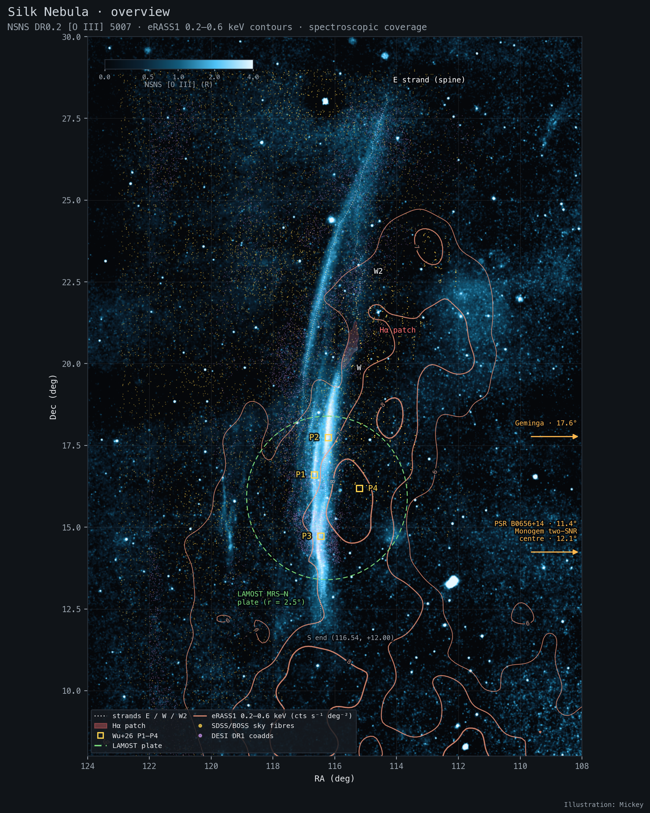
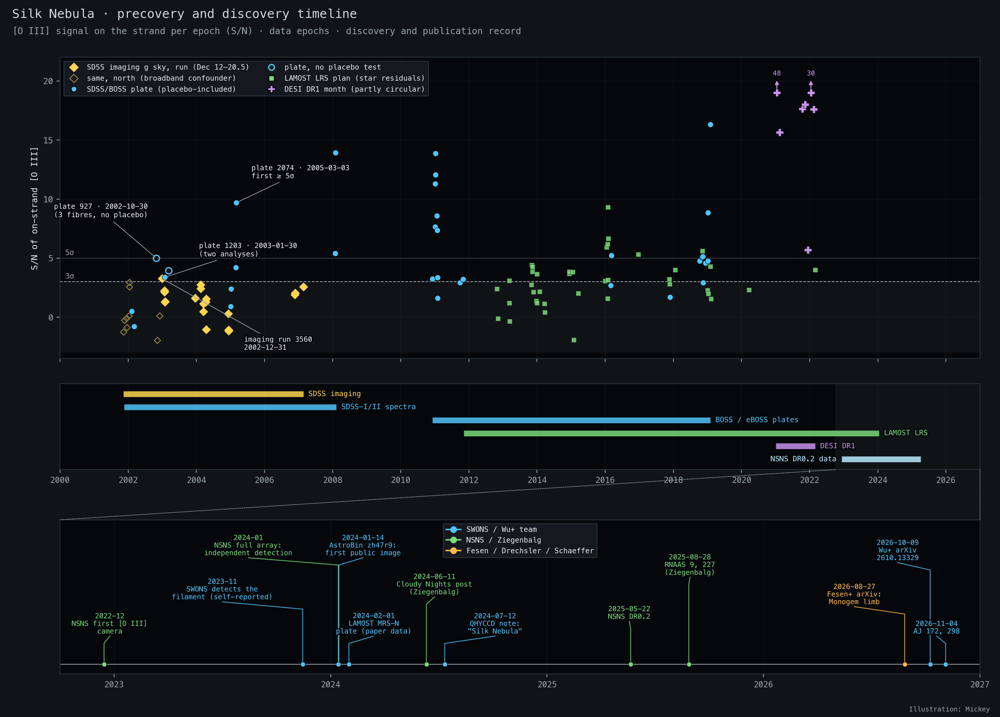
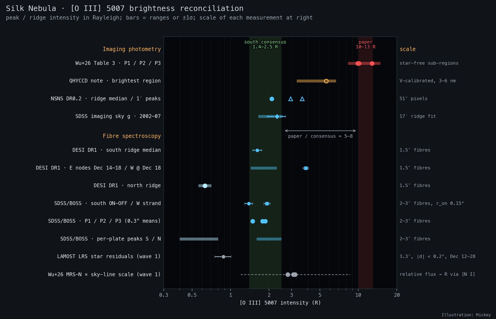
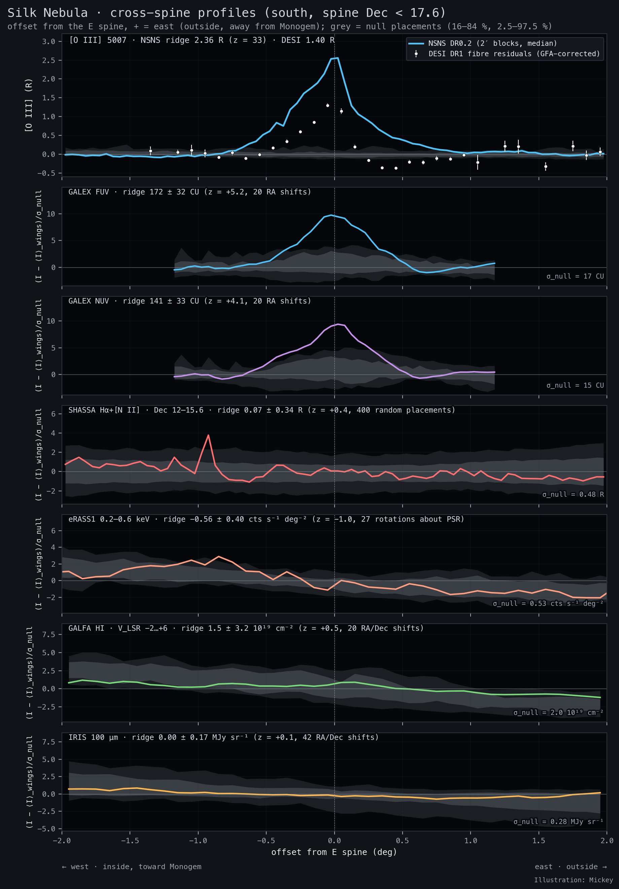
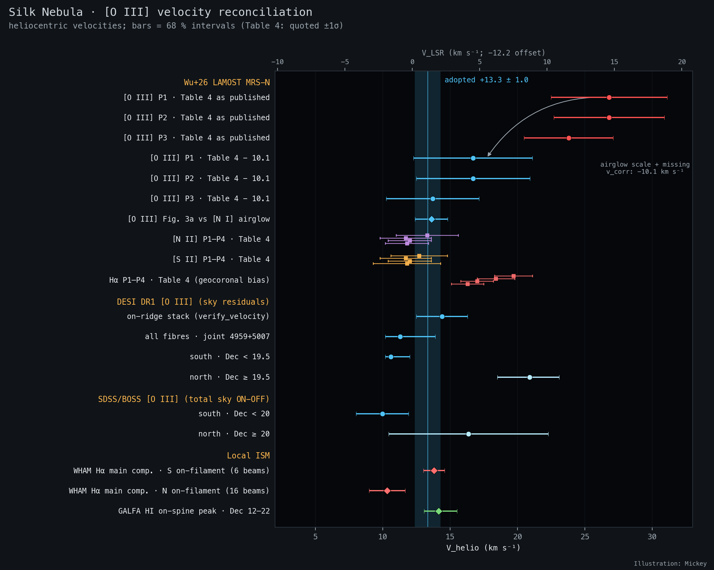
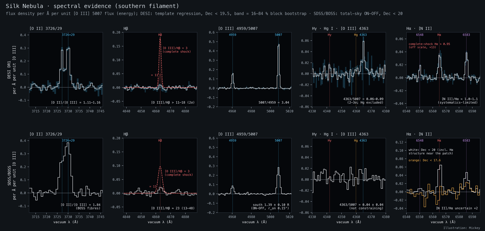
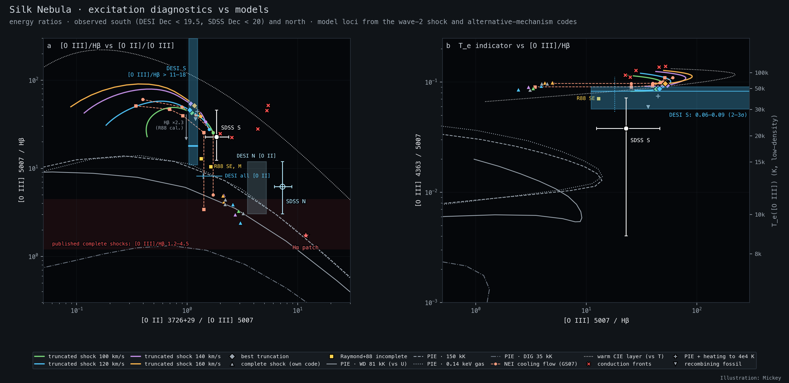

# 丝绸星云：发现、预发现，以及对其超新星遗迹判定的光谱学再审视

*English version: [REPORT.md](REPORT.md)*

*研究日期 2026-11-16/17。项目文件夹 `~/astronomy/silk-nebula`。*

*对 Wu et al. 2026 的评论另有期刊格式的稿件 [paper/silk_comment.pdf](paper/silk_comment.pdf)，该稿件是本研究最新、核查最仔细的表述。本报告已于 2026-11-18 与其核对一致。*

所有数值均来自本文件夹中的文件：
- 规范数值表（canonical values table）：`notes/w3_canon.md` 与 `data/derived/w3_canon_values.json`；
- 其后的第 3 轮（wave 3）笔记 `w3_oii` 与 `w3_northsouth`，以及第 4 轮笔记 `w4_*`，它们在必要处取代该表；
- 稿件及其分区域 DESI 分析（`notes/paper_appendix_desi.md`、`data/derived/paper_appendix_desi_summary.json`），在不一致之处取代以上两者。

本研究为多智能体（multi-agent）研究，分四轮进行：
1. 调研；
2. 对抗性验证与物理建模；
3. 结果协调、图件制作，以及由三位评审组成的假说评审组（hypothesis panel）；
4. 收尾检验。

各轮结论不一致时，以较晚一轮为准。

---

## 摘要

**它是什么。** 丝绸星云（Silk Nebula）是双子座/小犬座中的一条 [O III] λ5007 弧（arc），长 16.9°，宽度极窄。
- **主脊线（spine）：** (RA, Dec) = (116.54°, +12.00°) → (114.36°, +28.25°)；l ≈ 208°→191°，b ≈ +17.5°→+21.8°。
- **宽度：** 脊（ridge）的半高全宽（FWHM）为 0.28°。
- **W 分支（W strand）：** 第二条分支在 Dec +15° 附近分出，终止于 (115.47°, +20.54°) 附近一个小的 Hα + [S II] 斑块（patch）。

**独立发现者。** 共有三个团队各自独立发现了它：
- **SWONS**（2023 年 11 月/12 月）。首张公开图像：AstroBin，2024-01-14。
- **Stefan Ziegenbalg 的 NSNS** 巡天（~2024 年 1 月）。首篇期刊论文：RNAAS 9, 227，2025-08-28。
- **Schaeffer、Fesen 与 Drechsler**，他们将其作为 Monogem 环（Monogem Ring）的东北壳层边缘（limb）发表（arXiv:2608.26666，2026-08-27）。

关于 Sergey Koposov 在 DESI 数据中发现它的说法属于二手信息。公开的 DESI DR1 光谱中确实含有它，显著性 ~30σ。

**预发现（precovery）。** 该丝状结构（filament）至少自 2002 年起就已存在于存档数据中，比发现时间早约 21 年。
- **探测：**
  - SDSS 成像 g 波段天光水平（首个 ≥ 3σ 的扫描（run）为 2002-12-31）；
  - SDSS 天光光纤（sky fibre）：观测板（plate）1203（2003-01-30），经两项独立分析确认；首个 ≥ 5σ 探测为 2005-03-03；
  - BOSS/eBOSS、LAMOST LRS 恒星光谱残差（residual；自 2013 年起），以及 DESI DR1（2021–22）。
- **紫外：** GALEX 显示出与之吻合的远紫外（far-UV）与近紫外（near-UV）丝状结构。
- **未探测到：** 照相底片（DSS/POSS）与 Hα 巡天（南段的 SHASSA，以及 WHAM）。
- **无法检验：** Pan-STARRS 叠加图（stack）的构建方式决定了它对度尺度辐射完全不敏感；VTSS 则未覆盖主脊线。

**LAMOST 论文。** Wu et al. 2026（arXiv:2610.13329，AJ 172, 298）得出了“可能的超新星遗迹（SNR）”这一判定。论文包含三个数值错误（第 1–3 项），其中前两个是所给遗迹的尺度、能量、年龄及其“两个壳层”图像的基础；而该判定本身建立在一项归属错误的诊断（第 4 项）以及 [O III] 形态之上：
1. **基准距离 160 pc 是单位错误（unit slip）。** 表 4 将 `kd` 软件包的输出（单位为 kpc）列在“100 pc”标签之下。因此，该论文自身的运动学距离（kinematic distance）实为 ~1.6 kpc。况且在这一方向上，运动学距离本身就没有意义。
2. **[O III] 速度是定标假象（calibration artefact）。** 已发表的 +24 至 +27 km/s 处于空气波长、站心（topocentric）的波长标度上，缺少日心（heliocentric）改正；最简单的解释是蓝臂的波长参考被改为空气波长下的气辉（airglow）谱线。以论文自身图 3 的光谱、相对其中的 [N I] 气辉测量，得到 +13.6 ± 1.2 km/s。合并值为 V_helio = +13.3 ± 1.0 km/s（V_LSR ≈ +1；估计量系统误差 ±1 km/s），与本地温电离介质（WIM）及 HI 相同。北段偏红 +4–9 km/s，跟随北部 HI 的速度。因此，所声称的 [O III]/红臂谱线速度偏移，以及建立在其上的一切推论，均不复存在。
3. **亮度偏高 4.6–8.6×。** 所有经过流量定标的测量都给出南段脊上 ~1.4–2.5 R，而非 10–13 R。
4. **诊断归属错误。** 红臂的“激波”谱线比（line ratio；[S II]/Hα、[N II]/Hα、BPT）在无星云的背景区域 P4 中在 1σ 以内相同。论文自身也指出了这一点（其第 4.1、4.2 节），但仍认为遗迹占主导。这些谱线比描述的是前景/背景 WIM，而非该丝状结构。若按字面取值，论文表 2 的区域 [S II] 谱线比对应电子密度 n_e ≈ 225–631 cm⁻³，而非文中给出的 64–150（后者是逐根光纤测量值的平均值，并向中心升高）；但在表中所列强度误差范围内，这些比值无法约束密度。能量与年龄的计算建立在缺乏依据的输入之上。

**新光谱。** 我们通过两种方式测量了该丝状结构自身的光谱：
- **DESI DR1：** 7,620 条公开合并光谱（coadd），利用 DESI 逐焦面花瓣（petal）天光扣除（sky subtraction）后留下的残差。
- **SDSS/BOSS/SDSS-V：** 9,092 条天光光纤光谱，利用总天光谱（total sky）。

结果：
- **巴耳末线暗弱（Balmer-dark）：** [O III]/Hβ > 11（2σ；SDSS ≈ 23）；[O III]/Hα ≳ 3。
- **谱线比：** R23 > ~30（2σ；DESI 盒式积分（box）> 29）；[O II]3727/[O III] 在南段 ≈ 1.1–1.2，向北段升至 4–8；未探测到 He II 4686（He II/[O III] < 0.026）。
- **温度迹象：** [O III]4363/5007 ≈ 0.06–0.09（2–3σ），若属实，对应电子温度（electron temperature）T_e ≈ (3–6)×10⁴ K。
- **无其他对应体：** 没有 Hα、HI、尘埃或 X 射线丝状结构。

**它很可能是什么。**
- **被光谱连同电离源的缺失一起排除：** 光致电离平衡（photoionization equilibrium），无论是弥漫电离气体（DIG），还是由热白矮星或 Monogem 自身 EUV 电离的气体。光谱在 p ≤ 0.007 水平上否定了它，而且不存在足够的电离源。完全冷却的辐射激波（complete radiative shock）则被光谱本身排除。
- **基于物理理由排除：**
  - **热传导前沿（conduction front）：** 其远紫外下限过高，观测宽度要求过大的压强，且预言的电离次序错误。
  - **混合层（mixing layer）与热气体冷却：** 两者都预言存在 X 射线丝状结构，但并未观测到。
- **不被支持（disfavoured）但未被排除：**
  - **受加热的温气体层（heated warm layer），或光致电离加额外加热：** 这些情形能拟合光学谱线比，但需要一个身份不明、量级相当于激波的热源，且预言的 C IV 过少。
  - **热启动的化石气体（hot-start fossil）：** 需要在过去 ~1.5–4×10³ yr 内发生过加热，这实际上就是激波。
  - **C IV 证据：** C IV 水平由 GALEX FUV/[O III] 比值以及数字化的 Kim et al. (2007) FIMS/SPEAR C IV 图推断得到。其中 FIMS 部分假定其区域 R1 即为丝绸星云，这是一个 ~2σ 的空间吻合。
- **能够吻合的情景：** 一个 ~80–120 km/s（≲ 150）、未完全冷却（“柱密度截断”，column-truncated）的辐射激波的冷却区，以侧视片层（edge-on sheet）的形态呈现。在这种激波中，气体已被加热并正在辐射 [O III] 和 [O II]，但尚未冷却到足以使氢复合的程度。它能重现谱线比和远紫外水平；近紫外水平、[O II]–[O III] 脊的偏移以及 [O II] 双线比仍与之存在张力（§5.2）。
- **位置：** 南段主脊线位于 Monogem 环壳层的半径处，处在其软 X 射线（soft X-ray）辐射的局部外边缘上。
- **评审组结论：** 三位独立评审倾向于距离 ~250–320 pc 的 Monogem 壳层边缘方案，其后验概率（posterior）为 0.50–0.64。由另一个身份不明的源驱动的同类激波得到 0.26–0.29。论文中 160 pc、2×10⁵¹ erg 的 SNR 得到 ≤ 0.01。第 4 轮收尾检验后 P(激波) 维持在 ≈ 0.9，但与 Monogem 的空间对应（registration）仅获得中等程度的支持，似然比（likelihood ratio）为 ~4–10。总体权衡大致维持在 H1 0.5–0.6 对 H2 ~0.3。

**决定性的后续观测。**
- 远紫外光谱（C IV 双线比与 C IV/O III]），以及远紫外相对于 [O III] 的空间分层；
- 深度 Hβ、[O III]4363 与 [O II]7320–7330 光谱观测；以 R ≈ 4000–10,000 观测 [O II] 3726/3729 双线，可检验各情景共有的 2σ 密度张力，但无法对各情景排序；
- 对一组距离为 150–600 pc、可在距离上界定（bracket）该结构的白矮星进行 HST/COS C IV/Si IV 吸收线观测；
- 两历元自行（proper motion）测量：在 282 pc 处应为 ~60–120 mas yr⁻¹（对首选的激波速度 v_s = 80–120 km/s 为 ~60–90），静态气体层则为零；
- R ≥ 30,000 的 [O III] 谱线轮廓，用于检验片层几何。

*图 1. NSNS DR0.2 [O III] 图（S. Ziegenbalg），叠加了描迹得到的 E/W/W2 分支、Hα 斑块、论文中的区域 P1–P4、LAMOST 5° 观测板，以及 Monogem 的 eRASS1 0.2–0.6 keV 等值线。黄色和紫色圆点分别标出本文使用的 SDSS/BOSS 天光光纤与 DESI DR1 合并光谱。（`figures/w3_figs_f1_overview.png`）*

---

## 1. 发现与基本特征

### 1.1 时间线与发现归属

| 日期 | 事件 |
|---|---|
| 2002–2022 | 已存在于 SDSS、BOSS/eBOSS、LAMOST 和 DESI 的存档数据中（见图 2、§2 和 §4） |
| 2022-12 → 2024-01 | NSNS [O III] 相机开始运行；该弧（arc）出现在“完成全部配置后的第一个晴夜”（~2024 年 1 月；自述） |
| 2023-11 / 2023-12 | SWONS 探测到该结构（论文称 11 月；一位 SWONS 成员的博客称 12 月） |
| **2024-01-14** | **首张公开图像**：SWONS 成员 Song-Yu Jia 发布的 AstroBin `zh47r9`（“Huge Undiscovered [OIII] Structure”，1°×10°，无坐标） |
| 2024-02-01 | 以 HIP 37797 为中心的 LAMOST MRS-N 观测板（plate），即该论文所用数据 |
| 2024-06-11 | Ziegenbalg 在 Cloudy Nights 发帖：14° 弧，首次公开位置，“我会说它是一个超新星遗迹” |
| 2024-06/07 | T. Schaeffer（NHZ）：“是 Monogem 超新星遗迹（SNR）的一部分” |
| 2024-07-12 | QHYCCD 新闻稿：首次在英文中使用“Silk Nebula”（丝绸星云）这一名称（1.5°×15°） |
| 2025-06-11 | NSNS 星表条目 O200.0（16.9°×3.0°）；其北段位于 Monogem 之外；另提出 Geminga SNR 作为备选解释 |
| **2025-08-28** | **首篇期刊论文**：Ziegenbalg 2025，RNAAS 9, 227 |
| 2026-08-27 | Fesen et al. arXiv:2608.26666：该 15° [O III] 结构群是 Monogem 的东/北壳层边缘（limb）；文中未提及“Silk”或 SWONS |
| 2026-10-09 / 11-04 | Wu et al. arXiv:2610.13329 / AJ 172, 298 |

AJ 版本增加了一段致谢，承认 Fesen/Drechsler/Schaeffer 团队与 Ziegenbalg 团队独立发现了该星云。该版本保留了“由 SWONS 团队发现并命名”以及“首次探测到其完整范围”的表述。Koposov/DESI 的发现归属仅可追溯到 AstroBin 上的一条图片说明 `zwfplw`，其中转述了与 V. Belokurov 的一次谈话；不存在一手来源。详见 `notes/discovery.md`。

### 1.2 几何形态与亮度

*图 2. 在 SDSS 成像天光、SDSS/BOSS 观测板（含安慰剂检验）、LAMOST LRS 和 DESI DR1 中，该分支（strand）上逐历元的 [O III] 信号，以及发现与发表记录。（`figures/w3_figs_f7_timeline.png`）*

**主脊线（spine；`data/derived/silk_trace.json`）。** 我们在四幅以 Tycho-2 恒星配准的图像中测量了 66 个点，中位 σ 为 0.022°：
- 论文中的 SWONS 合成图；
- 论文图 4 的背景图像；
- NSNS 的窄视场与宽视场图像。

**长度。** 主脊线是一段 16.94° 的弧（弦长 16.38°）。各处引用的“1°×10°”、“15°”和“17°”等尺度反映的是不同的覆盖范围。论文自己的图 1 实际跨越 3.9° × 13.5°。

**宽度与分支。**
- **E 分支：** 半高全宽（FWHM）≈ 0.28°，在 282 pc 距离处相当于 1.4 pc。
- **W 分支：** 在 Dec 15–20 范围内承载了大部分 [O III]（SDSS：W 1.93 R 对 E 0.73 R）。
- **包络：** 论文所述的“~1° 宽度”是多个分支的包络。

**曲率。** 单个圆（R = 21.3°，圆心 (94.5°, +16.8°)）即可描述两半部分，rms 为 0.12–0.19°，不存在几何断点。形式上的 χ² 较差，仅仅是因为该弧在小尺度上有摆动。单独来看，南段较直（R ≈ 67°），并与 Monogem 圆相切延伸。北段向西弯曲。

**[O III] 亮度（采用值）。** 南段的脊（ridge）上约为 2 R（范围 1.4–2.5 R；DESI 参考值 1.62 R，定标不确定度约 20 %，见 §4.1），北段为 0.4–0.9 R。

| 测量 | [O III]5007（瑞利，R） |
|---|---|
| DESI DR1（按真实光纤接收率改正；南段数值的不确定度约 20 %，见 §4.1） | 南段 1.62；北段 0.56–0.71 |
| SDSS/BOSS 天光光纤（sky fibre），总天光谱（total sky）ON−OFF | 南段 1.39 ± 0.10（W 分支 1.93）；各观测板峰值：南段 1.6–2.5 / 北段 0.4–0.8 |
| SDSS 成像天光水平（17′ 尺度） | 2.3–2.6 |
| NSNS DR0.2 图 | ~2.0–2.2（1′ 峰值 3.0–3.6） |
| QHYCCD 新闻稿（24.3 mag/arcsec²） | 3.3–6.7 |
| **Wu et al. 表 3**（23.6–23.9 mag/arcsec²） | **10–13** |

论文的换算算术本身是正确的。逐区域比较，表 3 是各独立测量值的 4.6–8.6×。没有任何已识别的乘性系统误差能解释这样的倍数。我们检查过的候选因素包括 AB/Vega 星等系统、滤光片带宽、f/0.95 下的滤光片几何效应以及 λ4959 泄漏，而且 f/0.95 造成的偏移实际上会使结果偏低。7.9–11.3 R 的加性误差则可以做到这一点：相当于天光 6–20 % 的背景或平场误差，或者背景孔径中所含的暗弱星光少于星云孔径。论文（其第 3.1 节）自己也指出 P1 在图像中看起来最暗、测得的面亮度却最高，并将其归因于星光。核查这一点所需的 SWONS 输入数据并未公开。此外，若为激波，GALEX 远紫外（FUV）/[O III] 比值也使 10–13 R 与已发表的激波模型不相容。

*图 3. 各数据集给出的 [O III] 亮度，以及每项测量对应的角尺度。（`figures/w3_figs_f3_brightness.png`）*

---

## 2. 成像预发现与多波段对应体

| 巡天 / 波段 | 历元 | 结果 |
|---|---|---|
| **SDSS 成像天光水平（g）** | 2002-12 → 2007-02 | **统计上探测到：** 由 19 次核心扫描（run）得到脊亮度 2.3 ± 0.4 R，相对于相干零样本（null）为 3.9σ（不同估计量变体给出 1.4–4.6σ）。信号具有谱线特征：g 波段存在，r 和 i 波段不存在。u 波段显示 4.4σ 的 [O II]。在 ~2 倍的精度内未见变化。最早的 ≥ 3σ 扫描：2002-12-31 的 run 3560 |
| **GALEX FUV / NUV** | 2003–2012 | **探测到：** 一条与 [O III] 相吻合的丝状结构（filament），每 R [O III] 对应 FUV 68–92 CU、NUV 36–57 CU（南段 z = 8.7 和 6.5） |
| DSS1/DSS2（POSS-I/II） | 1950 年代–1990 年代 | 未探测到；DSS2 J 上限 < 14 × NSNS（≈ 40 R，3σ） |
| Pan-STARRS1 DR2 叠加图 | 2010–14 | 构造上即无法探测：叠加图的天光扣除（sky subtraction）会去除角分及更大尺度的辐射（甚至连 Medusa 行星状星云也会被去除） |
| Legacy Surveys | — | 无法访问（通过代理时 NERSC 主机被屏蔽）；而且同样经过天光扣除 |
| SHASSA Hα | 1997–2000 | 无 Hα：南段主脊线上 2σ < 0.77 R（Dec 12–15.6；唯一的角分级 Hα 覆盖） |
| WHAM-SS Hα / Finkbeiner 2003 | 1997–2003 | V_LSR ≈ 0 处的温电离介质（WIM），2.6–4.4 R，在该丝状结构上与结构外完全相同。沿 76 % 的主脊线，F03 仅基于 WHAM 数据（1°） |
| VTSS | — | 无覆盖 |
| eRASS1 DR1 / ROSAT 软 X 射线 | 1990, 2019–20 | **无 X 射线丝状结构。** 南段位于 Monogem 环 0.2–0.6 keV 峰值以外 ~1° 处，处在其外侧翼上；内侧比外侧更亮（W/E ≈ 1.25）。这种整体反差是该半径处壳层的普遍特征（相对于绕脉冲星旋转的对照，p = 0.37）。然而，在丝绸星云自身所在的位置角扇区内，对于已提出的全部三个 Monogem 中心，南段主脊线都位于局部外侧的半峰值边缘上（+0.19、+0.08、−0.06°；旋转检验 p ≈ 0.03–0.05） |
| FIMS/SPEAR 远紫外光谱图（Kim et al. 2007） | 2003-12 → 2004-01 | C IV 区域“R1”（8.7 ± 0.9 ×10³ LU）沿丝绸星云南段分布：安慰剂检验（placebo test）p ≈ 0.02，但该区域系事后选定，因此为 ~2σ；受波束限制。由此得到 C IV/[O III] ≈ 0.15–0.4（按光子数计）。注意事项：该图是从已发表的彩色图像数字化得到的，且该比值假定 R1 的全部超出量都来自丝绸星云 |
| GALFA-HI / LAB / HI4PI | — | 无 HI 丝状结构、壁、空腔或速度特征（每 2 km/s 速度切片 2σ < 1–1.75×10¹⁹ cm⁻²）。第 1 轮中的“HI 壁”是边缘搜寻方法造成的假象 |
| IRIS / Planck / SFD 尘埃 | — | 无对应体（ΔE(B−V) < 0.004） |
| Haslam 408 MHz、WMAP、Planck、Stockert 1.4 GHz | — | 无总强度对应体（Σ₁GHz < 1.3×10⁻²² W m⁻² Hz⁻¹ sr⁻¹）；Stockert 的一个 +19.5 mK 特征性质不明确。NVSS/TGSS 会滤除（resolve out）该丝状结构，因此论文中的射电未探测结果不能说明任何问题 |
| NVSS 法拉第旋转量（RM） | — | 在北半部，横跨该丝状结构确实存在一个 +36 rad m⁻² 的跃变，但随机放置位置的零样本检验给出 p = 0.18：并非该丝状结构所特有 |
| Fermi-LAT | — | 无任何发现 |
| 业余天文存档（AstroBin） | ≤ 2023-11 | 2023 年 11 月之前没有覆盖该脊的公开窄带图像 |

*图 4. 横跨南段主脊线的剖面。[O III]（NSNS、DESI）与 GALEX FUV/NUV 显示出同一条窄脊。SHASSA Hα、GALFA HI、IRIS 100 µm 和 eRASS1 X 射线均未显示该脊；X 射线梯度与绕 PSR B0656+14 旋转所得的对照相符。（`figures/w3_figs_f6_profiles.png`）*

---

## 3. LAMOST 论文及其超新星遗迹判定

### 3.1 论文做了什么

Wu et al. 观测了一块以 HIP 37797 为中心的 LAMOST MRS-N 观测板（2024-02-01，3 × 900 s，R ≈ 7500），获得 2,684 条可用光谱。
- **覆盖范围：** 蓝臂 4950–5350 Å，包含 [O III] 但**不含 Hβ**；红臂 6300–6800 Å。
- **方法：** 将亮区 P1–P3 与背景区 P4 进行比较。
- **结论：** 位于 ~160 pc 运动学距离（kinematic distance）处的一个“可能的超新星遗迹”，长 28 pc，E ≈ 2×10⁵¹ erg，年龄 ~6.8×10⁴ yr。弥漫电离气体（DIG）或电离泡“不能被排除”。
- **数据可得性：** MRS-N 星云光谱**未公开**。DR12 仅收录该观测板上 83 颗恒星的光谱，且同一研究组表示这些光纤数据尚未发布（arXiv:2510.08950）。因此无法重新测量逐根光纤的谱线。

### 3.2 逐条判定

| 论文论断 | 判定 | 证据 |
|---|---|---|
| 距离 ~160 pc（“表 4 以 100 pc 为单位”） | **错误：单位错误（unit slip）** | 我们采用 Reid+14 自转曲线（rotation curve）得到 P1/P2/P3 的距离为 1.785 / 1.743 / 1.154 kpc（论文印出值为 1.79 / 1.85 / 1.20）。若该列单位为 kpc，χ² 为 0.05；若为 ×100 pc，则 χ² 为 28.9（p = 2×10⁻⁶）。蒙特卡洛下限恰好落在 `kd` 的 0.01 kpc 网格最小值上。`kd` 源代码通篇注明单位为 kpc。AJ 正文未作改动，Crossref 亦未列出任何勘误 |
| 运动学距离可用 | **错误** | 朝 P1–P4 方向的自转速度梯度为 7.6–9.1 km/s/kpc（0–2 kpc 内的平均值），因此 ±7 km/s 的本动速度对应 ±0.8–0.9 kpc。采用修正后的 V_LSR ≈ +1，“距离”为 0–0.2 kpc。论文（其第 3.3 节）自己也指出该星云靠近运动学分析所排除的反银心区域的边界，并指出这使距离不确定 |
| [O III] V_helio +23.8…+26.8，与红臂谱线相差 10–16 km/s（“两个壳层”） | **错误：假象** | 论文的图 3 以矢量数据存储。在其绘图标尺上，[N I] 5198/5200 气辉（airglow）恰好位于其空气中静止波长处：蓝臂的波长标度为空气波长、站心（topocentric）参考系（最简单的解释是：蓝臂在流水线处理之后被重新以气辉的空气波长为参考），因此缺少 −8.3 km/s 的日心（heliocentric）改正，并带有一个 1.8 km/s 的偏移。改正量为 **−10.1 ± 1.0 km/s**；以该光谱自身气辉为参考，[O III] 为 **+13.6 ± 1.2**；[O III] − [N II] = +1.1 ± 1.3 km/s。LAMOST 恒星的蓝臂与红臂速度彼此一致，且与 Gaia 一致，因此弧灯定标没有问题 |
| LAMOST Hα +16…+20 km/s | **偏红 +4.5…+6.7 km/s；成因解释合理（仅基于模型）** | Hα − [N II] = +5.5 ± 1.1 km/s（4.9σ），Hα − WHAM = +4.8 ± 0.7，而 [N II] 与 WHAM 一致。在该观测板上，地冕 Hα（geocoronal Hα）谱线与星云谱线相距不足一个分辨元，且亮度相当。若同时拟合谱线宽度，约 30 % 的过度扣除可解释该偏差的一半至四分之三（仅基于模型；见 `DISPUTE.md` §4） |
| 面亮度（surface brightness）10–13 R | **偏高 4.6–8.6×** | 见 §1.2 |
| [S II]/Hα > 0.4、[N II]/Hα、BPT/SMB ⇒ 激波 | **归因错误** | 在无星云的 P4 中同样得到这些比值（[S II]/Hα 的 \|Δ\| ≤ 0.6σ，[N II]/Hα 的 \|Δ\| ≤ 0.72σ），且与高银纬暗弱温电离介质一致（WHAM，Madsen+06）。论文自身也指出 P4 满足其判据，且背景中的 [S II]/Hα 同样偏高（其第 4.1、4.2 节），但仍认为遗迹占主导。红臂谱线来自前景/背景 WIM，按该判据，背景本身也会被归为“受激波作用” |
| 由 [S II] 得 n_e ≈ 64–150 cm⁻³ | **表 2 不支持；描述的是 WIM** | 64 cm⁻³ 是 107 个逐根光纤测量值的平均值（论文图 7b），向中心升至 ~150。若按字面取值，论文表 2 的区域比值（1.03–1.19）用 5 能级 S⁺ 原子模型给出 **225–631 cm⁻³**（用其式 5 则为 169–400）；但在表中所列 ±0.02 的强度误差范围内，这些比值无法约束密度。两组数值都不能描述 [O III] 气体；就其亮度而言，[O III] 气体要求 n_e ~0.1–3 |
| T_e ~9000–10⁴ K、V_t 29–33 km/s、接近太阳值的 O/H | **无信息量** | 由表 2 的区域谱线宽度推得的温度，其不确定度 σ_T ≈ 7,300–10,700 K，P(T < 0) = 18–38 %，因此不能表明 P1–P3 比 P4 更热（论文依据逐根光纤数据报告该结构上的温度更高）。N2/N2S2Hα 是 H II 区的定标关系，被用在其有效范围之外（式 6 是线性的 Pettini & Pagel 关系，而非“三阶”）。式 6 给出 P1–P3 的 12 + log(O/H) = 8.81–8.84，P4 为 8.84：这些数值描述的是 WIM |
| 本征 [O III] 半高全宽 43–49 km/s | **尚未确立** | 若表中的 S/N ≈ 6 为积分值，则通过论文宽度截断条件的拟合，在真实宽度为 5–45 km/s 的任意取值下都返回 ~36–47 km/s。论文未定义其 S/N；若为峰值 S/N，则偏差较小，这些宽度将表明 ≈ 45 km/s |
| V_s 119 km/s、E 2×10⁵¹ erg、R_PDS 18 pc、年龄 6.8×10⁴ yr | **算术无误，输入缺乏依据** | 论文的输入可以复现 V_s = 119.3 km/s、E = 2.01×10⁵¹ erg，并在其所给不确定度范围内复现 R_PDS（17.1 pc，对比 18 ± 2.8 pc）和年龄（7.95×10⁴ yr，对比 (6.8 ± 1.8)×10⁴ yr）。印出的年龄公式中的“+1”在 Cioffi et al. (1988) 中为“+1/3”，属于印刷错误，不影响论文所给的年龄：采用“+1/3”和 R_PDS = 18 pc 即可复现 6.8×10⁴ yr。输入缺乏依据：30 pc 的壳层半径源自 160 pc 的距离，n₀ = 1.0 ± 0.3 cm⁻³ 是直接采用的假定值，V_s 则由 WIM 的 [S II] 密度推得。未探测到 Hβ（2σ 下 I(Hβ) ≤ 0.15 R，由 DESI 在 1.62 R 处的 [O III]/Hβ > 11 得到）将 ~280 pc 处任何完全冷却的（发射巴耳末线的）激波约束为 n₀ ≤ 0.005–0.043 cm⁻³、E ≤ 4.2×10⁴⁹–3.8×10⁵⁰ erg（模型标度关系） |
| 无 NVSS/TGSS 射电探测 ⇒ 年老 SNR | **无信息量** | 干涉仪会滤除宽 17′ 的丝状结构 |
| 属于 Monogem 环（据 Fesen）却位于 160 pc | **内部自相矛盾** | Monogem 环位于 ~288–300 pc |
| 沿该结构探测到 [O III] 丝状结构，P4 中不存在 | **正确** | 已由 DESI、SDSS 光纤、SDSS 成像和 NSNS 证实 |
| 红臂谱线来自 DIG/WIM | **正确（就红臂谱线而言）** | WHAM 在丝状结构上与结构外完全相同 |
| “可能的 SNR / 激波” | **可以成立，但理由不同** | 见 §5 |

论文审查列出了 18 处内部矛盾，例如所谓第 3.4 节中的“膨胀速度 ~140 km/s”实际并不存在。几何分析又发现了更多问题：
- 论文表 1 中 P1/P4 的位置与论文图 1b 所绘轮廓相距 0.42–0.48°。
- 论文图 4 绘出了 173 根 [O III] 光纤，而正文称“279”根。

详见 `notes/paper_review.md`、`notes/verify_paper.md` 和 `notes/verify_velocity.md`。

*图 5. 日心速度。表 4 的 [O III]（红色）比其他所有测量值高 ~10 km/s。经改正并以论文自身的气辉为参考重新测量后，它与 DESI、SDSS、LAMOST [N II]/[S II]、WHAM Hα 以及本地 HI 一致，均为 +13.3 ± 1.0 km/s。（`figures/w3_figs_f2_velocity.png`）*

---

## 4. 新光谱：DESI DR1、SDSS/BOSS/SDSS-V 与 LAMOST LRS

### 4.1 方法

**DESI DR1**（公开；光谱经 NOIRLab SPARCL 获取，星表经 Data Lab TAP 获取）。
- **原理：** DESI 对每个焦面花瓣（petal）扣除一条平均天光谱。平滑的星云会被一并扣除，但尺度小于一个焦面花瓣的结构会在丝状结构上留下正残差（residual），并在其附近留下负残差。
- **数据：** 丝状结构轨迹周围条带内的 7,620 条星系/QSO 合并光谱（coadd），外加对照样本。仅保留 ±40 Å 的谱线窗口。这些是 DR1 中星系与类星体目标的合并光谱，并已减去红移拟合模型；它们不是 DESI 天光光纤光谱。
- **分析：** 焦面花瓣正演模型以及基于 [O III] 的模板回归（template regression）给出丝状结构自身的谱线比（line ratio），不含平滑 DIG 的贡献。
- **定标：** 第 1 轮中光纤接收因子的一个错误（误用了 Legacy Surveys 归一化，而非导星相机（GFA）接收率）已被发现并改正（×0.736）。DR1 未给出两个巡天验证（survey-validation）观测天区（tile）80644 与 80683 的导星相机接收率；P1 周围 0.5° 内 85 % 的光纤、P3 附近的全部光纤，以及 Dec < 19.5° 处 46 % 的可用光纤都来自这两个天区，故改用观测项目的中位值（`notes/paper_appendix_desi.md`）。因此，P1 与 P3 附近的 DESI 亮度以及南段中位值 1.62 R 的不确定度约为 20 %，而非实测接收率对应的 ±8 %。相对于论文表 3 的倍数不受影响：表 3 是 P1 和 P3 处 DESI 模型天空亮度的 6.2 和 6.6 倍（相对于全部独立数据为 4.6–8.6×）。
- **无法获取：** DESI 天光光纤和逐焦面花瓣天光模型存放在 NERSC（`data.desi.lbl.gov`），本机无法访问。

**SDSS-I/II、BOSS/eBOSS 与 SDSS-V DR19 天光光纤。**
- **数据：** 9,092 条光谱，分属 302 个观测板–观测夜–光谱仪组（其中 250 个为暗天光组）。
- **原理：** 银河系 [O III] 和 Hβ 谱线处没有显著的气辉，因此总天光谱（即残差 + 天光模型）可对星云进行绝对测量。
- **分析：** 在每个组内做 ON−OFF 叠加；零点取自 [O I]5577；漫射光改正以成像数据的天光为基准。第 1 轮中的一个错误（使用了流水线残差，而其随光纤变化的天光模型吸收了 ~40–50 % 的信号）已被改正。

**LAMOST LRS DR12** 恒星残差叠加（2,500 颗 ON / 1,500 颗 OFF 恒星）给出一个独立探测：[O III] 0.88 ± 0.13 R，无 Hβ。这是第 1 轮的数值，未经重新核验。它是 |d| < 0.2° 及 Dec 12–28 范围内的平均值，因此相对于脊上的数值有所稀释。

### 4.2 结果

**探测。** DESI 单独即可在 Dec +14 至 +28 范围内追踪该丝状结构，相对经验零样本的显著性为 ~30σ。在每个 Dec 区间、观测项目、目标类别以及观测天区（tile）/HEALPix 刀切法检验（jackknife）中，探测均成立。SDSS 天光光纤沿其全长均探测到该丝状结构。

**速度。**
- **全部数据：** V_helio = **+13.3 ± 1.0 km/s**（V_LSR +1.2 ± 1.0；估计量系统误差 ±1 km/s），来自 DESI、SDSS 以及论文的图 3a。仅用 DESI 与 SDSS 得到 +12.9 ± 1.6 km/s。
- **分区域（DESI，P1 与 P3 周围 0.5° 内；`notes/paper_appendix_desi.md`）：** P1 为 +11.9 ± 1.9 km/s（61 根光纤；ON−OFF 叠加为 +12.3 ± 1.1），与采用值一致。P3 为 +9.2 ± 1.0 km/s（128 根光纤；ON−OFF 为 +8.0 ± 0.9），低 4–5 km/s。在 P3 内部，ON−OFF 速度在 E 主脊线以东为 +11.2 ± 1.1 km/s，以西为 +5.5 ± 1.0 km/s（相差 3–4σ）。DESI ±1.5 km/s 的零点不确定度需另计。
- **E 分支与 W 分支：** 无显著差异。
- **北段与南段：** 北段偏红 +4 至 +9 km/s（ΔV_LSR +7 至 +11）。
  - 这一结果依赖 DESI，幅度取决于所用估计量，六种估计量给出的显著性为 1.8–3.7σ。DESI 与 SDSS 在 Dec 17.6–21 处不一致。
  - 北侧 HI 成分（V_LSR +8.5…+11.3）速度相近；将其视为激波前气体是一个假设。

**丝状结构的谱线比**（能量比；除非另有说明，均指南段）：

| 比值 | DESI DR1 | SDSS/BOSS | 采用值 |
|---|---|---|---|
| [O III]5007/Hβ | > 11（盒式积分）/ > 18（高斯），2σ | ≈ 23（13–48；光子数比）；计入安慰剂检验系统误差后 2σ 下为 > 5–7.5 | **> 11（2σ）；可能为 15–25** |
| R23 | > 29–34（2σ） | ≈ 76（> 20） | **> ~30** |
| [O II]3727/[O III] | 1.11–1.16（Dec < 19.5） | 1.17（Dec < 17.6） | **南段 ≈ 1.1–1.2 → 北段 4–8** |
| He II 4686/[O III] | < 0.026（97.5 %；为自助法（bootstrap）百分位数，未计入无谱线零样本窗口的弥散：rms 0.02，最大 0.05） | < 0.04 | **< 0.026（未探测到）** |
| [O III]4363/5007 | 0.06–0.09（2–3σ）；谱线位于 4364.6–4364.7 Å，因此排除了 Hg I 4358 路灯谱线 | 0.04 ± 0.04（无约束力） | **2–3σ 的迹象；若属实，T_e ≈ (3–6)×10⁴ K** |
| [O II]7320+7330/3727 | 0.060（0.055–0.073；南段 0.064），OH 系统误差 ±0.015，已修正一个 ×1.8 的归一化错误 | — | **T(O II) ≈ (2.4–5.5)×10⁴ K** |
| [O II]3729/3726 | 1.31 ± 0.07（偏离低密度极限 2σ） | 受仪器限制（双线混合、蓝端定标） | **无定论** |
| [Ne III]3869/[O III] | 0.07–0.10 | — | 测量值（置信度低） |
| [N II]/Hα、[S II]/Hα | ~1.0–1.2、0.5–0.75 | 0.7、0.6（南段） | **受系统误差限制（×2）；无法与脊上、脊外光纤之间的 WIM 反差区分开** |
| [O III]/Hα | > 3.4（直接测量） | > 3.0（Dec < 17.6，安慰剂检验） | **≳ 3（光子数比，2σ）** |

**北段与 Hα 斑块（Hα patch）。**
- **北段弧：** 较暗，[O III]/Hβ 较低（~6–8，SDSS 中心值），[O II]/[O III] 较高（4–8）：属于较低激发度的光谱。
- **Hα 斑块：** 在 SDSS ON−OFF 叠加谱中（平滑的 WIM 在其中相互抵消）呈现类激波的低电离光谱：[S II]/Hα = 1.04、[N II]/Hα = 0.78、[O II]/Hβ ≈ 13、[O III]/Hβ = 1.7（能量比；[S II]/Hα 与 [O III]/Hβ 的光子数比分别为 1.06 和 1.8），以及未红化的 B 情形（case B）巴耳末减幅（Balmer decrement）。它与 Planck 冷云核（cold clump）PGCC G199.09+19.95 相距 0.35°（冷中性介质（CNM）位于 V_LSR −0.7 和 +6.5 km/s）。

*图 6. 丝状结构自身的光谱（DESI 回归与 SDSS/BOSS 总天光谱 ON−OFF），以 [O III]5007 归一化：[O II] 与 [O III] 一样强，Hβ 较弱（参考曲线对应 [O III]/Hβ = 3 和 11），且 [O III]4363 位于 [O III] 的波长处而非 Hg I 处。SDSS [O II] 子图采用第 2 轮的 BOSS 叠加，给出 [O II]/[O III] ≈ 1.8。当前南段数值为 Dec < 17.6 处的 1.17（见 §4.2）。（`figures/w3_figs_f4_spectra.png`）*

---

## 5. 解释：化学与动力学线索，以及修正后的假说

### 5.1 光谱排除了什么

*图 7. 观测谱线比与各模型轨迹的对比：截断激波（truncated shock）轨迹（100–160 km/s）、完全冷却的辐射激波（complete radiative shock）、任意电离参数下的光致电离平衡（photoionization equilibrium）模型（热白矮星、150 kK、0.14 keV 气体、DIG）、冷却流、温碰撞电离平衡（warm-CIE）层、热传导前沿（conduction front）以及化石（复合中）气体（fossil gas）。需注意两点：激波轨迹取自第 2 轮的计算（100–160 km/s，拟合于已撤回的 [O III]/Hβ ≈ 46 被修正之前）；SDSS 南段数据点显示的是已被取代的 [O II]/[O III] = 1.84。第 4 轮的重新拟合倾向于激波速度 v_s ≈ 80–120 km/s。（`figures/w3_figs_f5_diagnostics.png`）*

第 4 轮用修正后的输入重新拟合了所有情景（`notes/w4_refit.md`），得到两个层次的排除结论。

**由光谱排除（对光致电离而言，还需结合电离源的缺失）**
- **光致电离平衡（photoionization equilibrium）。** 包括 DIG、“电离泡”、热白矮星，以及 Monogem 环或本地泡（Local Bubble）的极紫外（EUV）辐射。光谱在 p ≤ 0.007 水平上否定了它（8 项的 χ² = 21–51；若 4363 受系统误差下限限制，则 χ² = 18–25，p ≤ 0.02）。
  - 处于光致电离平衡的气体只能达到 [O III]/Hβ ≲ 10–14 和 4363/5007 ≲ 0.012–0.034，DIG 只能达到 [O III]/Hβ ≤ 1.3。
  - 对热气体谱而言，He II/[O III] 应为 0.06，而观测值 < 0.026。
  - 确定的排除结论还依赖于电离源的缺失：即使对已编目的最佳电离源——位于 150 pc 的 81 kK DOZ 型白矮星 WD J0736+1444——电离参数也偏低 18–30× 至 10⁴×。
- **完全冷却的辐射激波。** 10 项的 χ² ≥ 37。
  - 只能达到 [O III]/Hβ ≤ 5（自有代码 2.4–5.0；已发表模型网格 1.2–4.5）。
  - 会产生 Hα 丝状结构和冷却后的 HI，二者均未观测到。
  - 仅其非共振紫外谱线（每 R 85–277 CU）就已达到或超过实测的 GALEX FUV 水平。

**光谱上可接受，但在物理上被排除或不被支持**
- **湍流混合层（turbulent mixing layer）与 Monogem 环热气体的非平衡冷却（non-equilibrium cooling）。** 二者都预言存在一条比 Monogem 环亮 10³–10⁴× 的软 X 射线丝状结构，而实际并未观测到。混合层还需要近跨声速的流入：在边缘增亮因子（limb gain）G ≈ 19 时需 ~380 km/s，即使 G = 50 时仍需 ~140 km/s。
- **热传导前沿。** 其非共振 FUV 下限（179–213 CU/R）过高；1.4 pc 的宽度需要 P/k ~10⁶；且预言 C IV/[O III] 为 1.6–16，而 FIMS 给出 0.15–0.4。
- **静态加热的 ~6×10⁴ K 温气体层（warm layer）：不被支持，但未被排除。** 它能拟合光学谱线比（χ² 6/9）。但它需要一个来源不明、量级与激波相当的加热通量（0.5–2.6×10⁻⁵ erg cm⁻² s⁻¹），且处于热不稳定的温度。它预言的 C IV 过少（比 FIMS 所示水平低 4–10×），也不产生远紫外（far-UV）/[O III] 空间偏移。在获得远紫外光谱、深度 Hβ 观测或自行（proper motion）测量之前，评审（judges）给予它的 ~5 % 份额应予维持。
- **光致电离加额外加热至 4×10⁴ K：不被支持，但未被排除。** 它能拟合光学谱线比（9 项的 χ² = 1.0–2.4），但需要 78–350× 的光致加热，以及同样缺失的电离源。
- **热启动的化石气体（hot-start fossil）：不被支持。** 需要在最近 ~1.5–4×10³ yr 内发生一次加热事件，而这本身就是一次激波。

### 5.2 什么能够吻合

该光谱属于碰撞加热的气体，温度约 3–6×10⁴ K，其中的氢尚未复合：
- 巴耳末线暗弱（Balmer-dark）；
- [O II] 与 [O III] 强度大致相当；
- 未探测到 He II（仅有上限）；
- 4363 给出的 2–3σ 温度迹象；
- 远紫外与近紫外（near-UV）谱线发射。

**未完全冷却（柱密度截断）的辐射激波（column-truncated (incomplete) radiative shock）** 可以重现谱线比和远紫外水平，但预言的近紫外偏高 1.5–2 倍（每 R 79–99 CU，对比实测 36–57 CU），与模型系统误差相当。所用模型为我们自己的非平衡激波代码，已对照已发表的模型网格进行验证，并用修正后的输入重新拟合（`notes/verify_shockmodel.md`、`notes/w4_refit.md`）。该代码不含辐射转移，因此其在中等柱密度处的 Hβ 约为 Raymond et al. (1988) 的一半；为此每次拟合都以模型 Hβ × 2.3 重复了一遍。
- **拟合质量：** 10 项、四个参数的最佳 χ² 为 0.3；480 个网格模型中有 279 个落在 Δχ² = 4 以内。
- **激波：** v_s ≥ 80 km/s。计入完整的远紫外谱线收支后，倾向于 ~80–120 km/s（≲ 150）。
- **截断：** log N* ≈ 17.4–18.7 cm⁻²，即截断发生在氢复合之前，此时 T* ≈ 1–3×10⁴ K。
- **预言谱线比：** [O III]/Hβ 13–62；[O II]/[O III] 1.0–1.8；4363/5007 0.08–0.10；[O II]7325/[O III] 0.06–0.12。
- **几何：**
  - 光滑弯曲的 58 pc 壳层边缘在约 2σ 水平上不被支持（p ≈ 0.04–0.09），但未被排除。它预言横截面轮廓明显不对称（σ_W/σ_E ≈ 2–6），而南段轮廓近乎对称：1.07（1.00–1.16），真实天区弥散为 ±0.17。这一形状无法区分 H1 与 H2。
  - **侧视的平坦或缓弯/起伏片层（edge-on sheet）** 可行（视线方向矢高 ≲ 深度，边缘增亮因子 ≲ 15）：激波前密度（pre-shock density）n₀ ≈ 0.012–0.13 cm⁻³（中位数 0.024），冲压（ram pressure）P/k ≈ 1.2×10⁴–5.5×10⁵（中位数 5.5×10⁴ K cm⁻³，∝ 1/d），视线深度 3.5–59 pc。
  - 该压强与 Monogem 环内部相当，但在这种几何下，“压强匹配”不再是独立证据：亮度只决定深度。
- **谱线宽度（line width）：** 对平坦的侧视片层，半高全宽 ≈ 11–13 km/s（热展宽），中心速度等于激波前气体的速度。5–10° 的倾斜会使中心速度移动 5–19 km/s 而不展宽谱线；只有起伏片层才会给出 20–50 km/s。
- **时标：** 激波已传播 2–11×10⁴ yr，短于其冷却时间，因此截断是自然的结果。
- **紫外：**
  - **GALEX：** 若 C IV 被压低 ~5×，FUV 比值（每 R 68–92 CU；按 DESI 标度 ≈ 85–115）即可吻合。片层内的侧视共振散射（resonance scattering）可以实现这一点（有效透过率 0.12–0.57；模型 68–143 CU/R）。
  - **FIMS：** 平坦片层模型预言 C IV/[O III] ≈ 0.04–0.18（按光子数计）。若数字化 FIMS 图中 R1 区的超额辐射来自丝绸星云，则该图意味着 0.15–0.4，处于上述范围的上端或更高，即需要 ~2.5–9× 的压低。
  - **分层：** 模型预言 FUV 脊在外侧领先 [O III] +0.04…+0.10°。GALEX 只显示一个向东的 FUV 翼（模板平移 +0.067°，p ≈ 0.09），而 FUV 峰值仍位于 [O III] 脊上。这略微支持激波所预期的符号，似然比（likelihood ratio）~4–14，但不构成探测。

这与天鹅座环（Cygnus Loop）中未完全冷却激波所产生的 [O III] 丝状结构（Raymond et al. 1988）物理机制相同，只是激波前密度低 ~35–370×（中位数 ~180×）。

**尚存的张力。** 除上述近紫外水平外，还有两处。二者都不是决定性的：
- DESI 的 [O II] 脊略偏于 [O III] 的*东侧*（+0.04–0.05°）。一维激波预言的方向与此相反，该预言在 p ≈ 0.003–0.07 水平上不被支持。双成分，或 WIM/焦面花瓣系统误差，可以解释这一点。
- DESI 的 [O II] 3729/3726 = 1.31 ± 0.07，与所有低密度情景所预言的低密度值 1.46 相差 2.1–2.7σ。

### 5.3 动力学线索

- **速度与本地气体相同。** [O III] 与 WIM、本地 HI 以及本地 Ca II/Na I 同速运动（V_LSR ≈ 0–2 km/s）。对于在切点处被侧视的激波，视向速度就是激波前气体的速度。膨胀发生在天球切平面内。
- **不存在系统性分裂。** 论文中 [O III] 与红臂谱线（[N II]/[S II]）之间 10–16 km/s 的速度分裂，以及建立在其上的“两个壳层”，都源于定标错误。
- **北段。** 其速度偏红 +4–9 km/s（取决于所用估计量），更暗，激发度更低。
  - **激波速度：** 这与较慢的激波相符（~60–110 km/s，中位数 ~80）。只有压强与边缘增亮因子的乘积受到约束，为南段值的 0.1–3.3×。
  - **红移的来源：** 更红的激波前气体（V_LSR +8.5…+11 处的 HI，假定二者成协）、3–10° 的倾斜，或单侧视线弦（one-sided chord）。从远侧观测的单个膨胀球体无法解释这一点。
  - **Hα/[S II] 斑块：** 看起来像是局部的激波—云相互作用，其中激波已完全冷却。这一解读是定性的。相邻的冷云核有迹象表明位于 ≳ 400 pc（星表值 262 ± 121 pc），因此二者相邻可能只是投影效应。
- **轮廓形状。**
  - **北段：** 稳健地呈单侧不对称（σ_W/σ_E = 2.28，而对称零假设下为 1.01 ± 0.08，p ≈ 0.02），东缘陡峭，凹侧朝西。壳层边缘或单侧视线弦可以拟合；平坦条带则不能。
  - **南段：** 近乎对称（1.07）。这更符合被爆炸波触及的较平坦片层，而非光滑弯曲的壳层边缘；后者在 ~2σ 水平上不被支持。

### 5.4 化学线索

无法声称存在任何丰度异常。在非平衡激波中，强线丰度指标（N2、N2S2Hα、R23 定标）均不适用，论文中的“接近太阳值的 O/H”描述的是 WIM。模型拟合全程采用太阳丰度。在所述系统误差范围内，没有任何结果要求增丰（如行星状星云或 Wolf–Rayet 星抛射物）或贫化：
- [Ne III]/[O III] ≈ 0.07–0.10；
- He I 5876 < 0.005；
- [N II]/Hα ~1，受系统误差限制。

其诊断内容在于**热结构与电离结构**（巴耳末线暗弱、R23、T_e），而非化学组成。

### 5.5 它在哪里，由什么驱动？

**距离。** 若南段主脊线是 Monogem 环的壳层边缘，则距离为 **252–318 pc（68 %；中位数 282）**。这一结论依据的是：主脊线距 Knies et al. (2024) 双遗迹中心 12.10 ± 0.12°，接近 Monogem 环的壳层半径（11.0 ± 1.1°）；并假定壳层中心位于 PSR B0656+14 的视差距离（288 pc）处。南段主脊线比 Monogem 圆更直（曲率半径 ≈ 67°），仅与之相切。目前没有任何测量直接给出距离：
- 没有吸收线能够界定电离气体的距离范围；
- 没有尘埃；
- 运动学不提供信息。

从 ~100 pc 到 ~1 kpc 的任何距离都是允许的。160 pc（位于 161–171 pc 处的本地泡壁上）并未被测量排除。~1.6 kpc 不被支持：此时该丝状结构长 470 pc，位于 z ≈ 0.55 kpc，且南北速度梯度的符号与银河系自转相反。

**假说评审组（hypothesis panel）**（`notes/w3_judge_{obs,phys,skeptic}.md`）。三位独立评审分别从不同视角为每个假说打分。评分按原记录保留，未因 2026-11-18 与稿件的核对而重新评定：

| 假说 | 观测证据视角 | 物理自洽视角 | 唱反调视角 |
|---|---|---|---|
| H1 Monogem 环外侧壳层边缘上的未完全冷却辐射激波，~250–320 pc | 0.50 | 0.64 | 0.60 |
| H2 同类激波，但驱动源不同或未知（更老的 SNR、G205.6+12.4、本地泡壁、Geminga 碎片） | 0.29 | 0.26 | 0.27 |
| H3 论文模型：160 pc 处的独立 SNR，2×10⁵¹ erg，6.8×10⁴ yr | 0.01 | 0.005 | 0.005 |
| H4 1–2 kpc 处的超泡壁 | 0.04 | 0.04 | 0.035 |
| H5 DIG / 光致电离泡壁 | 0.02 | 0.01 | 0.01 |
| 其他 / 未知：热传导、混合、冷却流、受加热的温气体层、化石气体、未预料到的机制（各评审的归类方式不同） | 0.14 | 0.045* | 0.08 |

\*物理自洽视角评审的 0.045 中包含 0.008，分配给其新增的两种激波机制：逃逸星或脉冲星弓形激波，以及下落高速云产生的激波。

三位评审给出的 P(激波加热, 任意驱动源) 均 ≈ 0.84–0.95。他们指出的最薄弱环节：
- **距离：** 与 Monogem 环的关联主要依赖于一个几何巧合。评审估计其偶然概率为 p ≈ 0.03–0.07，计入 look-elsewhere 效应后贝叶斯因子（Bayes factor）为 ~10–20。第 4 轮结果取代了这些数值：P ≈ 0.09，似然比 ~4–10。
- **输入：** 若干诊断量（4363、[O II] 双线、Hβ 中心值）处于 2–3σ 水平。
- **C IV 压低：** 该因子（~5×）依赖于模型。
- **谱线宽度：** [O III] 的宽度从未以足够的分辨率测量过。

**收尾检验（第 4 轮）**
- **以单一明确定义的零假设重新计算偶然巧合概率。** 将刚性轨迹随机放置于同一纬度带内，在轨迹触及某一壳缘的条件下，其与 Monogem 环半径相符的概率为 0.09。这对应的似然比仅为 ~4–10，而非某位评审算出的 60–120。在丝绸星云自身所在的扇区内，无论采用哪个已提出的中心，南段主脊线都位于 eRASS1 外侧半峰值边缘上，这消除了“仅对某一个中心成立”的异议。
- **Hα 斑块旁的冷云核**（PGCC G199.09+19.95）似乎位于 ~400–650 pc（~2–2.5σ 的恒星消光迹象），而非 250–320 pc。需注意两点：PGCC 星表给出 262 ± 121 pc，且三维尘埃图（3D dust map）无法分辨该云核。各三维尘埃图沿该脊在 250–320 pc 处均未显示尘埃层。这削弱了 H1 的“第二个巧合”，即该斑块恰好位于 Monogem 环半径上。
- **Monogem 家族。** 在 Monogem 环的其他 [O III] 丝状结构中，只有 Fesen 的暗弱东侧丝状结构“E1”有可用的 DESI 光谱。它巴耳末线较弱、[O II] 较强，与丝绸星云北段相似。其 V_LSR 为 −24 km/s，因此东侧各丝状结构并不共享同一切向速度。这既不证实也不否定 H1。决定性的类比对象——位于同一圆上的 Monogem 环南侧壳层边缘“S1”——没有可用的公开光谱。
- **远紫外。** Kim et al. (2007) 的 FIMS/SPEAR C IV 区域 R1 沿丝绸星云南段分布。这适度加强了 C IV 被压低的激波相对于温气体层或热传导前沿的优势。

**综合结论。** P(激波加热, 任意驱动源) ≈ 0.9（不变或略有提高）。归属于 Monogem 环的解释仍占优，但证据更为单薄：H1 ≈ 0.5–0.6，H2 ≈ 0.3。距离尚未测得。

---

## 6. 决定性的后续观测

1. **远紫外光谱**（沿丝绸星云方向的 FIMS/SPEAR 存档数据，或未来的紫外任务）可以不依赖距离地区分激波与静态气体：
   - **截断激波（平坦片层）：** C IV 在片层中为光学厚，因此 1548/1551 双线比为 ~1.0–1.3，预测 C IV/[O III] ≈ 0.04–0.18（按光子数计）。数字化 FIMS 图所隐含的值为 0.15–0.4。
   - **温气体层：** 双线比 ≈ 2，C IV/[O III] ≈ 0.03–0.04。
   - **热传导前沿：** C IV/[O III] ≳ 1.6。
2. **R ≈ 4000–10,000 的深度长缝或 IFU 光谱观测**，对象为明亮的南段分支，覆盖 Hβ、[O III]4363、He II 4686、[O II]7320–7330（需要无 OH 污染的天光扣除，±0.007）以及分辨开的 [O II] 3726/3729 双线。这将解决电子温度 T_e 的问题。该双线可检验各情景共同面临的 2σ 密度张力，但不能对各情景排序，因为所有情景都预测 ≈ 1.46。表中“温气体层”一栏还列出了“光致电离 + 加热”变体，该变体在 Hβ 和 4363 上与激波重叠。

| 谱线比 | 截断激波 | 温气体层 |
|---|---|---|
| [O III]/Hβ | 17–61 | ~97（光致电离 + 加热：~45） |
| 4363/5007 | 0.082–0.091 | ~0.098（光致电离 + 加热：~0.075） |
| [O II]7325/3727 | 0.056–0.067 | ~0.082 |
| [O II] 双线 | ≈ 1.46 | ≈ 1.46 |

3. **两历元 [O III] 自行。** 在 282 pc 处的预期值：对于首选的激波速度 v_s = 80–120 km/s 为 ~60–90 mas yr⁻¹（对所有仍成立的平坦片层解为 60–120；若 v_s = 100–150 则为 75–112）。其他距离处的预期值：160 pc 处约大 1.8×，1 kpc 处约小 3.5×。任何静态气体层的自行均为零。
   - **第 1 历元：** SWONS 后续观测的原始帧（ε-180ED + QHY600，1.55″/px）。其拍摄日期未见发表，属于发现时期（2023–2024 年）。
   - **第 1b 历元：** 2026–27 年对南段核心（Dec 13–16）、交汇处（Dec 17–19）和锐利的北缘（Dec 21–26）进行 ≤ 1″/px 的成像。
   - **第 2 历元：** 2034–36 年。
   - **精度：** 要在 10–12 yr 内探测到 282 pc 处的运动，每个历元的边缘定位精度需达到 ≲ 0.1–0.15″。
   - **距离：** 结合由深度 Hβ 观测或远紫外光谱得到的激波速度，可由 d = v_s / (4.74 μ) 求得距离。只有在起伏或弯曲的几何形态下，谱线宽度才能测量 v_s。
4. **HST/COS 高电离离子吸收线距离界定（bracket）**（C IV、Si IV）。`notes/w4_distance.md` 列出了距脊 0.3° 以内、距离为 120–800 pc 的 52 颗热星。它们均无存档紫外光谱；其中 18 颗可在 ≤ 5 个轨道内于 C IV 处达到 S/N 15。
   - **推荐的白矮星：** 南段为 154、234（DA 29.7 kK）、294、389、445 和 594（DO 84 kK）pc；北段为 407 和 588 pc。
   - **H1 下的预测：** 具有丝绸星云速度的 C IV 只在 ~250–320 pc 以远出现。
   - **快速存档步骤：** 分析类星体 QSO 2MASS J07452815+1919525 已有的 COS G130M 光谱，该源距 W 分支 0.34°。该光谱覆盖 Si IV 和 N V，不覆盖 C IV。
5. **Monogem 南侧壳层边缘“S1”的光谱观测**（例如 (106.0°, +3.47°)、(112.5°, +4.05°)）。它与丝绸星云南段位于同一圆上。H1 预测其呈现同样的巴耳末线暗弱光谱，V_LSR ≈ 0 ± 5 km/s。
6. **R ≥ 30,000 的 [O III] 谱线轮廓。** 平坦的侧视片层给出 ~11–13 km/s（热展宽），若片层倾斜，中心速度可能偏移 5–19 km/s；起伏或弯曲的片层给出 20–50 km/s。
7. **更深的 eROSITA/XMM 光谱观测**，针对 X 射线明亮一侧：内部压强轮廓，以及丝绸星云所在扇区内的局部边缘。
8. **2024-02-01 观测板的公开 LAMOST MRS-N 光纤光谱**将能够逐光纤检验 −10.1 km/s 的速度改正。

---

## 7. 数据获取、局限性与可复现性

**无法访问或未公开**
- NERSC 主机（`data.desi.lbl.gov`、`legacysurvey.org`）无法通过本机的代理访问。因此未使用 DESI 天光光纤、逐焦面花瓣天光模型和 Legacy Surveys 图像。DESI 光谱经由 NOIRLab SPARCL 获取，其速率为 ~1 条光谱/s。
- `cdsarc.cds.unistra.fr` 无法访问，因此改用 VizieR 镜像。
- LAMOST MRS-N 星云光纤光谱未公开。
- SWONS 测光输入（滤光片曲线、孔径、零点）未公开。

**测量局限**
- 若干关键比值处于 2–3σ 水平。DESI 与模板相关的系统误差下限为 [O III] 的 ~0.05（无谱线零样本窗口的弥散 rms 为 0.02，最大 0.05），因此低于该水平的 DESI 比值均为上限。He II 上限是自助法（bootstrap）百分位数，未计入这一弥散。
- P1 与 P3 附近的 DESI 面亮度以及南段中位值 1.62 R 的不确定度约为 20 %，因为 DR1 未给出两个巡天验证观测天区的导星相机光纤接收率（§4.1）。
- SDSS 成像与 DESI 之间的 [O III] 绝对标度之比为 1.5 ± 0.25（`notes/w3_canon.md` 中的 C3）。
- `notes/w3_canon.md` §12–13 列出了 15 处智能体之间的冲突和 20 处文件层面的不一致。其中若干冲突后来已由 `w3_oii` 和 `w3_northsouth` 解决或修订（C2、C5、C6、C8）。其已被取代数值登记表（§15）编制于第 3/4 轮修正之前。

**研究过程中发现并改正的错误**
- DESI 光纤接收因子（fibre-acceptance factor）；
- SDSS 采用残差还是总天光谱的选择；
- [O II]7325 双线归一化（×1.8）；
- X 射线“边缘”的显著性；
- “HI 壁”假象；
- 已撤回的初步分析值 [O III]/Hβ ≈ 47；
- PSR J0751+1807 的过时星表数值；
- 完全冷却激波约束所依据的、已被取代的 Hβ 上限，以及两个 DESI 巡天验证观测天区缺失的导星相机接收率（二者均在 2026-11-18 撰写和审查稿件时发现）。

已被取代数值的登记表见 `notes/w3_canon.md` §15。

**目录结构**

| 路径 | 内容 |
|---|---|
| `notes/` | 按主题划分的笔记：第 1 轮 `discovery`、`paper_review`、`geometry`、`context`、`imaging_optical`、`imaging_mw`、`spectra_desi`、`spectra_sdss_lamost`、`spectra_ism`；第 2 轮 `verify_*`；第 3 轮 `w3_*`；第 4 轮 `w4_*` |
| `figures/` | 全部图件。报告用合成图：`w3_figs_f1…f7` |
| `scripts/` | 全部分析代码（使用 `~/.venvs/astro313/bin/python -I scripts/<name>.py` 运行）。共用辅助模块：`silk_geometry.py`、`silk_style.py` |
| `data/raw/` | 下载数据，每个来源一个文件夹 |
| `data/derived/` | 测量结果；`silk_trace.json`；`w3_canon_values.json`；各轮智能体结果 `wave{1,2,3,4}_agent_results.json` |
| `sources/` | 论文（PDF、文本、HTML）及网页抓取存档 |

## 参考来源

- Wu et al. 2026, "The Silk Nebula: A Newly Discovered Giant [O III] Emission Filament", [arXiv:2610.13329](https://arxiv.org/abs/2610.13329); AJ 172, 298, [doi:10.3847/1538-3881/aeb11c](https://doi.org/10.3847/1538-3881/aeb11c)
- Fesen et al. 2026, [arXiv:2608.26666](https://arxiv.org/abs/2608.26666)（Monogem 光学丝状结构）
- Ziegenbalg 2025, RNAAS 9, 227, [doi:10.3847/2515-5172/adfec7](https://doi.org/10.3847/2515-5172/adfec7)；NSNS 页面 [simg.de/nebulae3/gem-01.html](https://simg.de/nebulae3/gem-01.html)
- [QHYCCD 新闻稿，2024-07-12](https://www.qhyccd.com/silk-nebula-discovered-by-enthusiast-astronomers-with-qhyccd-cameras/)；[AstroBin 论坛帖子 126958](https://app.astrobin.com/forum/topic/126958/silk-nebula-discovered-by-enthusiast-astronomers-with-qhyccd-cameras)；[AstroBin zwfplw](https://app.astrobin.com/i/zwfplw)
- Kim et al. 2007, ApJ 665, L139（Monogem 环的 FIMS/SPEAR 远紫外发射）
- Edenhofer et al. 2024（三维尘埃图）；O'Neill et al. 2024（本地泡壁）；Planck Collaboration 2016, XXVIII（PGCC 星表）；Anders et al. 2022（StarHorse）；Gentile Fusillo et al. 2021（Gaia 白矮星）；Culpan et al. 2022（热亚矮星）；Madsen et al. 2006（WIM 谱线比）
- Raymond et al. 1988（天鹅座环中的未完全冷却激波）
- Knies et al. 2024（eROSITA 的 Monogem 观测），[arXiv:2401.17289](https://arxiv.org/abs/2401.17289)；Saydjari et al. 2026（DESI 天光光纤），[arXiv:2608.28740](https://arxiv.org/abs/2608.28740)；LAMOST MRS-N 数据发布状态，[arXiv:2510.08950](https://arxiv.org/abs/2510.08950)
- 公开数据：
  - DESI DR1，经由 [NOIRLab Data Lab / SPARCL](https://datalab.noirlab.edu)；
  - SDSS DR17/DR18/DR19（[SAS](https://data.sdss.org/sas/dr17/)、[DR19](https://data.sdss5.org)）；
  - LAMOST DR12（[lamost.org](https://www.lamost.org)）；
  - [eROSITA DR1](https://erosita.mpe.mpg.de/dr1/)；
  - GALEX（MAST）；
  - SkyView（DSS、SHASSA、RASS、IRIS、Haslam、NVSS）；
  - [LAMBDA](https://lambda.gsfc.nasa.gov)（Finkbeiner Hα、WMAP/Planck）；
  - WHAM-SS DR1；
  - GALFA-HI DR2；
  - NSNS DR0.2 HiPS（S. Ziegenbalg，CC-BY-NC-SA）；
  - Gaia DR3；
  - ATNF psrcat 2.9.0；
  - ESO/ELODIE/SOPHIE 存档；
  - HST/COS 和 IUE，经由 MAST。
